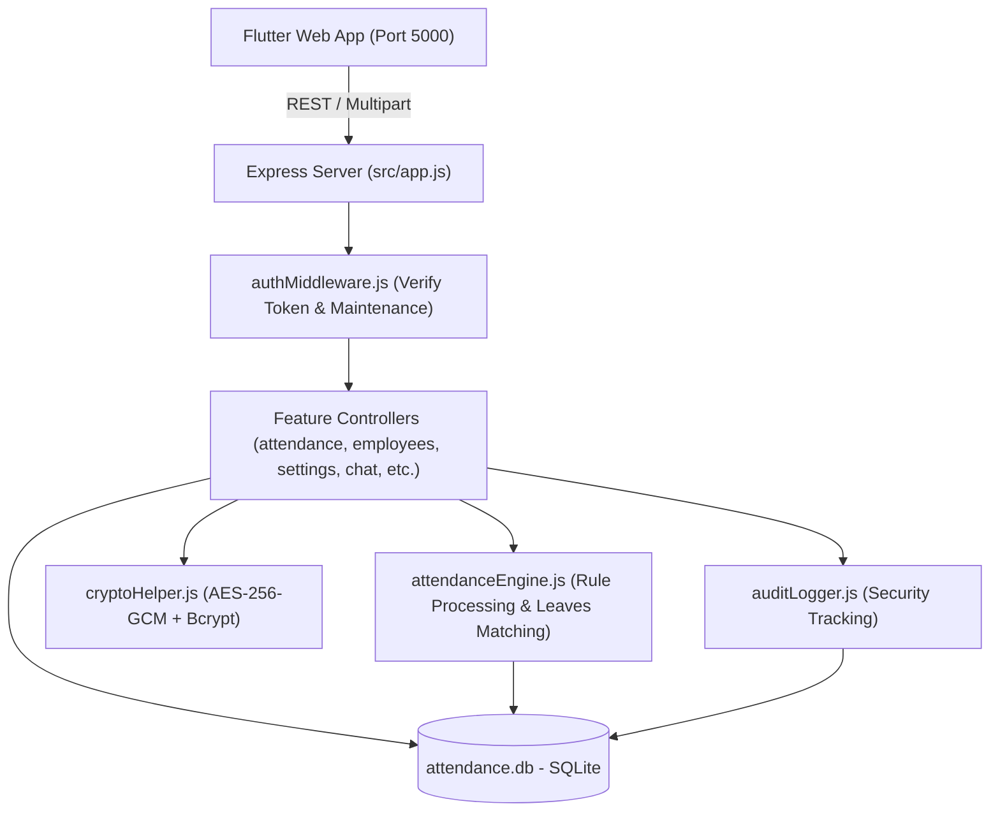
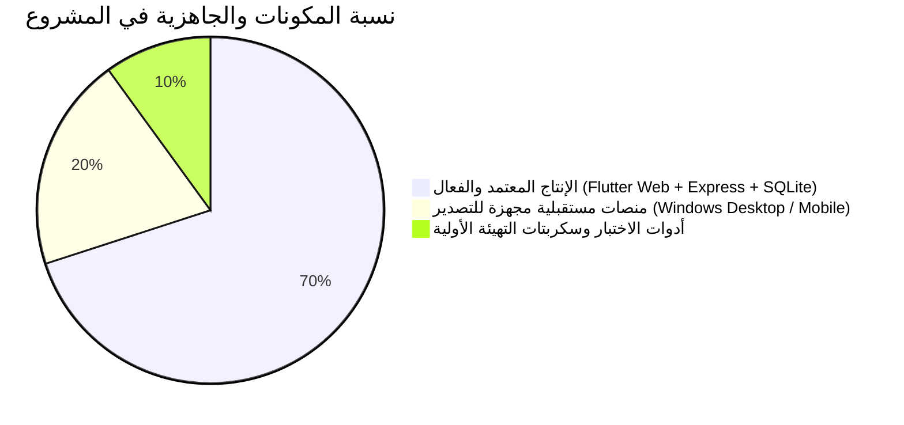

# 🌳 الموسوعة الهيكلية والمعمارية الحية لنظام كشف حضور وانصراف موظفي المقر
## (File Tree & Living Code Encyclopedia - Employee NOCI)

* **المسار الجذري:** `D:\Employee NOCI`
* **الحالة التشغيلية:** الإنتاج المعتمد (Production Active - Port 5000)
* **الإصدار الحالي:** 2.0.0
* **طبيعة الوثيقة:** مرجع معماري وبرمجي حي وشامل (Living Blueprint) — يُوثّق كل ملف، دالة، مسار، معرف، وعلاقة ربط، ويوضح ما هو مستخدم وما هو مؤجل، ليكون الدستور الدائم للبرنامج.

---

## 📑 الفهرس العام للموسوعة

1. [الشجرة الهيكلية المنقحة والمعتمدة (Clean File Tree)](#1-الشجرة-الهيكلية-المنقحة-والمعتمدة-clean-file-tree)
2. [التشريح المفصل لطبقة الواجهة الأمامية (Frontend - Flutter Web & Multiplatform)](#2-التشريح-المفصل-لطبقة-الواجهة-الأمامية-frontend---flutter-web--multiplatform)
3. [التشريح المفصل لطبقة الخادم ومحرك الذكاء الاصطناعي (Backend & Intelligence Engine)](#3-التشريح-المفصل-لطبقة-الخادم-ومحرك-الذكاء-الاصطناعي-backend--intelligence-engine)
4. [مصفوفة الارتباط التتبعي الشامل (End-to-End Traceability Matrix: ما هو مربوط بماذا؟ ولماذا؟)](#4-مصفوفة-الارتباط-التتبعي-الشامل-end-to-end-traceability-matrix)
5. [قاموس المعرفات، المتغيرات الحاكمة، والرموز المشفرة (Identifiers & Enums Dictionary)](#5-قاموس-المعرفات-المتغيرات-الحاكمة-والرموز-المشفرة-identifiers--enums-dictionary)
6. [دليل السكربتات وأوامر التشغيل والأتمتة (Scripts & Operations Runbook)](#6-دليل-السكربتات-وأوامر-التشغيل-والأتمتة-scripts--operations-runbook)
7. [الجرد الشامل: العناصر الفعالة والمستخدمة مقابل العناصر غير المستخدمة / المؤجلة](#7-الجرد-الشامل-العناصر-الفعالة-والمستخدمة-مقابل-العناصر-غير-المستخدمة--المؤجلة)
8. [بروتوكول التحديث المستمر والتطوير المستقبلي (Living Maintenance Protocol)](#8-بروتوكول-التحديث-المستمر-والتطوير-المستقبلي-living-maintenance-protocol)

---

## 1. الشجرة الهيكلية المنقحة والمعتمدة (Clean File Tree)

```text
D:\Employee NOCI
├── 📁 app                                      # تطبيق الواجهة الأمامية المبني بإطار عمل Flutter
│   ├── 📁 lib                                  # الشيفرة المصدرية الأساسية للتطبيق (Dart)
│   │   ├── 📁 core                             # النواة المركزية (إدارة الجلسات، الاتصال، السمات، الثوابت)
│   │   │   ├── 📄 api_client.dart             # عميل الاتصال الموحد بالخادم عبر HTTP/REST
│   │   │   ├── 📄 auth_provider.dart          # إدارة حالة تسجيل الدخول، الصلاحيات، والتخزين المحلي
│   │   │   ├── 📄 constants.dart              # الثوابت الرقمية، الألوان الأساسية، والمسارات
│   │   │   └── 📄 theme.dart                  # سمة التطبيق الموحدة (ألوان متناسقة، خط تجوال، تباين عالي)
│   │   ├── 📁 features                         # الوحدات الوظيفية المقسمة وفق معمارية Feature-First
│   │   │   ├── 📁 attendance                   # وحدة كشف الحضور والانصراف
│   │   │   │   ├── 📄 attendance_screen.dart   # شاشة عرض كشف اليوم، التحليل، والاعتماد
│   │   │   │   └── 📄 upload_dialog.dart       # نافذة رفع وتحليل ملف إكسل البصمة الذاتي
│   │   │   ├── 📁 audit_logs                   # وحدة سجل النشاطات والأمان
│   │   │   │   └── 📄 audit_logs_screen.dart   # شاشة استعراض نشاطات المستخدمين وتتبع العمليات
│   │   │   ├── 📁 auth                         # وحدة الأمان والمصادقة
│   │   │   │   ├── 📄 login_screen.dart        # شاشة تسجيل الدخول مع خيار "تذكر بياناتي"
│   │   │   │   ├── 📄 maintenance_screen.dart  # شاشة الحظر التلقائي أثناء وضع الصيانة
│   │   │   │   └── 📄 profile_dialog.dart      # نافذة تعديل بيانات الحساب وكلمة المرور
│   │   │   ├── 📁 chat                         # وحدة المحادثات الفورية والرقابة الشاملة
│   │   │   │   └── 📄 chat_screen.dart         # غرف المحادثة + سجل الرقابة المحمي بكلمة سر
│   │   │   ├── 📁 dashboard                    # وحدة لوحة القيادة والمؤشرات العامة
│   │   │   │   └── 📄 dashboard_screen.dart    # مؤشرات KPI اللحظية، الرسوم البيانية، والإحصائيات
│   │   │   ├── 📁 employees                    # وحدة إدارة سجل الموظفين
│   │   │   │   ├── 📄 employee_dialog.dart     # نافذة إضافة/تعديل موظف وملفه الشامل
│   │   │   │   └── 📄 employees_screen.dart    # السجل العام مع التلوين الذكي التلقائي للحالات
│   │   │   ├── 📁 leaves                       # وحدة إدارة الإجازات والعطلات
│   │   │   │   └── 📄 leaves_screen.dart       # تسجيل ومتابعة الإجازات وتحديد تواريخ سريانها
│   │   │   ├── 📁 reports                      # وحدة التقارير الشاملة والتصدير
│   │   │   │   └── 📄 reports_screen.dart      # استخراج تقارير إكسل و PDF مع خيارات الفلترة
│   │   │   ├── 📁 schedules                    # وحدة جداول الدوام والراحة الأسبوعية
│   │   │   │   └── 📄 schedules_screen.dart    # ضبط فترات الدوام وإدارة قوالب الشفتات
│   │   │   └── 📁 settings                     # وحدة إعدادات النظام والصيانة المتقدمة
│   │   │       └── 📄 settings_screen.dart     # الهوية، الصلاحيات، ألوان الحالات، والنسخ الاحتياطي
│   │   ├── 📁 shared                           # العناصر المشتركة القابلة لإعادة الاستخدام (Shared Widgets)
│   │   │   ├── 📄 custom_button.dart           # أزرار قياسية موحدة التصميم والتفاعل
│   │   │   ├── 📄 kpi_card.dart                # بطاقات المؤشرات الإحصائية في لوحة التحكم
│   │   │   ├── 📄 main_layout.dart             # الإطار الهيكلي العام (الشريط الجانبي، العلوي، والتنقل)
│   │   │   └── 📄 status_badge.dart            # شارات ملونة موحدة لحالات الحضور والموظفين
│   │   ├── 📁 tools                            # أدوات مساعدة للحسابات والمظهر
│   │   │   ├── 📄 date_formatter.dart          # تنسيق وتوحيد التواريخ بالتوقيت المحلي (العراق +03:00)
│   │   │   └── 📄 responsive.dart              # التجاوب مع أحجام الشاشات المختلفة
│   │   └── 📄 main.dart                        # نقطة البداية لتطبيق فلاتر وتوجيه المسارات
│   ├── 📁 web                                  # الملفات الخاصة بتشغيل التطبيق على الويب (HTML/Manifest)
│   │   ├── 🌐 index.html                       # الصفحة الرئيسية للويب وإعدادات الخطوط والـ CanvasKit
│   │   ├── ⚙️ manifest.json                    # بيانات تطبيق الويب التقدمي (PWA)
│   │   └── 📁 icons                            # أيقونات التطبيق بدقة متعددة
│   ├── 📁 windows                              # منصة سطح المكتب لويندوز (مجهزة للبناء المكتبي)
│   ├── 📁 android                              # منصة أندرويد (جاهزة للتصدير المكتبي/المحمول مستقبلاً)
│   ├── 📁 ios                                  # منصة أبل iOS (جاهزة للتصدير مستقبلاً)
│   ├── 📁 linux                                # منصة لينكس (مكتبات العرض المجهزة)
│   ├── 📁 macos                                # منصة ماك (حزم التشغيل والشهادات)
│   ├── 📁 test                                 # اختبارات فلاتر للتحقق من سلامة الويدجتات
│   ├── ⚙️ analysis_options.yaml                # ضبط قواعد التدقيق البرمجي (0 تحذيرات في VS Code)
│   ├── ⚙️ pubspec.yaml                         # تعريف المكتبات الخارجية، الخطوط، وأصول التطبيق
│   └── 📄 pubspec.lock                         # تثبيت الإصدارات الدقيقة لحزم دارت
├── 📁 backend                                  # خادم النظام المركزي المبني بـ Node.js & Express
│   ├── 📁 data                                 # المستودع الفيزيائي لقاعدة البيانات والملفات المؤقتة
│   │   ├── 📄 attendance.db                    # قاعدة بيانات SQLite المشفرة والرئيسية للنظام
│   │   ├── 📁 backups                          # مجلد النسخ الاحتياطية المضغوطة والتلقائية
│   │   ├── 📁 branding                         # شعارات المؤسسة المرفوعة وخلفيات النظام
│   │   └── 📁 temp_uploads                     # ملفات الإكسل المرفوعة أثناء المعالجة المؤقتة
│   ├── 📁 public                               # ملفات تطبيق الويب المبنية والمجهزة للإنتاج (Production Bundle)
│   ├── 📁 scripts                              # سكربتات التهيئة الأولية والاختبارات الآلية
│   │   ├── 📄 seed_employees.js               # استيراد وتغذية بيانات الموظفين من ملف الإكسل الأولي
│   │   ├── 📄 test_api.js                      # فحص واختبار مسارات الـ REST APIs تلقائياً
│   │   ├── 📄 test_engine.js                   # اختبار خوارزميات محرك الحضور والذكاء الاصطناعي
│   │   └── 📄 test_v2.js                       # اختبار تكاملي للمرحلة الثانية من التحديثات
│   ├── 📁 src                                  # الشيفرة المصدرية لمخدم النظام (Backend Source Code)
│   │   ├── 📁 core                             # البنية التحتية الأساسية والخدمات المركزية
│   │   │   ├── 📄 auditLogger.js               # مسجل الحركات الأمنية الصارم في جدول audit_logs
│   │   │   ├── 📄 authMiddleware.js            # جدار الحماية، فحص التوكن، والتحقق من وضع الصيانة
│   │   │   ├── 📄 config.js                    # إعدادات النظام، المنافذ (5000)، ومفاتيح التشفير
│   │   │   ├── 📄 cryptoHelper.js              # أدوات التشفير العسكري AES-256-GCM ودوال Bcrypt
│   │   │   └── 📄 database.js                  # إدارة اتصال SQLite، بناء الجداول، والمؤشرات
│   │   ├── 📁 features                         # وحدات التحكم والمنطق مقسمة حسب المجال (Domains)
│   │   │   ├── 📁 attendance                   # إدارة الكشوف ومحرك المعالجة
│   │   │   │   ├── 📄 attendanceController.js  # معالجة طلبات رفع الكشف، تحليله، واعتماده
│   │   │   │   ├── 📄 attendanceEngine.js      # محرك الذكاء الاصطناعي لحساب التأخير والإجازات
│   │   │   │   └── 📄 attendanceRoutes.js      # مسارات API لكشوف الحضور والانصراف
│   │   │   ├── 📁 audit_logs                   # سجل الرقابة والأمان
│   │   │   │   ├── 📄 auditController.js       # استعلام وفلترة سجلات التدقيق للمدير العام
│   │   │   │   └── 📄 auditRoutes.js           # مسارات استرجاع سجلات النشاط
│   │   │   ├── 📁 auth                         # تسجيل الدخول وتوثيق الهوية
│   │   │   │   ├── 📄 authController.js        # مصادقة المستخدمين، التحقق، وتغيير كلمات السر
│   │   │   │   └── 📄 authRoutes.js            # مسارات الدخول، فحص التوكن، والتحقق الآمن
│   │   │   ├── 📁 backup                       # منظومة النسخ الاحتياطي والاستعادة
│   │   │   │   ├── 📄 backupController.js      # إنشاء النسخة، ضغطها، تصديرها، واستعادتها بكلمة سر
│   │   │   │   └── 📄 backupRoutes.js          # مسارات النسخ الاحتياطي والتنزيل والاستعادة
│   │   │   ├── 📁 chat                         # المحادثات اللحظية وسجل الرقابة
│   │   │   │   ├── 📄 chatController.js        # إرسال الرسائل، حفظها مشفرة، وتفريغ سجل الرقابة
│   │   │   │   └── 📄 chatRoutes.js            # مسارات الرسائل وتتبع الرقابة الشاملة
│   │   │   ├── 📁 employees                    # سجل الموظفين
│   │   │   │   ├── 📄 employeeController.js    # إدارة الموظفين، البحث، الفلترة، وتلوين الحالات
│   │   │   │   └── 📄 employeeRoutes.js        # مسارات عمليات الموظفين (CRUD)
│   │   │   ├── 📁 leaves                       # الإجازات والعطلات
│   │   │   │   ├── 📄 leaveController.js       # تسجيل الإجازة، تدقيق فترتها، وتحديث ملف الموظف
│   │   │   │   └── 📄 leaveRoutes.js           # مسارات تسجيل وفحص الإجازات السارية
│   │   │   ├── 📁 reports                      # توليد التقارير المتقدمة
│   │   │   │   ├── 📄 reportController.js      # تجميع الإحصائيات وتوليد ملفات Excel / PDF
│   │   │   │   └── 📄 reportRoutes.js          # مسارات تصدير التقارير المتنوعة
│   │   │   ├── 📁 schedules                    # جداول الدوام والراحة
│   │   │   │   ├── 📄 scheduleController.js    # إدارة شفتات الموظفين، أيام الأوف، والقوالب
│   │   │   │   └── 📄 scheduleRoutes.js        # مسارات حفظ واسترجاع قوالب وسجلات الدوام
│   │   │   └── 📁 settings                     # إعدادات النظام وتخصيص الهوية
│   │   │       ├── 📄 settingController.js     # حفظ الهوية، ألوان الحالات، وضع الصيانة، والتصفير
│   │   │       └── 📄 settingRoutes.js         # مسارات قراءة وحفظ وتحديث إعدادات النظام
│   │   ├── 📁 shared                           # دوال الاستجابة والثوابت المشتركة
│   │   │   ├── 📄 constants.js                 # أكواد الأخطاء، الأدوار، والحالات الثابتة
│   │   │   └── 📄 responseHelper.js            # قوالب الرد الموحدة (Success/Error JSON Responses)
│   │   ├── 📁 tools                            # معالجة الملفات والتواريخ
│   │   │   ├── 📄 excelHelper.js               # محرك قراءة وفك تشفير ملفات بصمة ZKTeco إكسل
│   │   │   └── 📄 timeUtils.js                 # دوال حساب فروق الوقت، الدقائق، وفترات الشفتات
│   │   └── 📄 app.js                           # نقطة انطلاق سيرفر Node.js وربط الـ Middleware والمسارات
│   ├── ⚙️ package.json                         # حزم وتبيعات الباك إند وأوامر التشغيل
│   └── ⚙️ package-lock.json                    # الإقفال الآمن لإصدارات حزم NPM
├── 📁 toolkit                                  # أدوات التشغيل والخدمات الخلفية التلقائية
│   ├── 📄 install-startup-service.bat          # تثبيت وتشغيل السيرفر تلقائياً مع إقلاع ويندوز
│   ├── 📄 run-local.bat                        # تشغيل محلي فوري لخادم الباك إند
│   ├── 📄 run-silent.vbs                       # تشغيل السيرفر في الخلفية تماماً بدون إظهار شاشة سوداء
│   ├── 📄 setup-cloudflare-tunnel.ps1         # سكربت ربط النظام بنفق Cloudflare للوصول عن بُعد
│   ├── 📄 stop-server.bat                      # سكربت إنهاء وإيقاف سيرفر المنفذ 5000 فوراً
│   └── 📝 README.md                            # دليل استخدام أدوات مجلد التولكيت
├── 📁 اساس                                     # الملفات المرجعية الأساسية للمقر وقوالب البصمة
│   ├── 📁 نموذج كشف الحضور                     # قوالب ونماذج كشوفات البصمة الخام
│   │   └── 📄 20-10-2026.xlsx                  # نموذج كشف فعلي لأجهزة البصمة المعتمدة
│   ├── 📄 اسماء موظفين المقر.xlsx              # الكشف الرسمي المعتمد لأسماء وأقسام ورمز بصمة الموظفين
│   └── 📝 File_Tree_Employee_NOCI.md           # الموسوعة الهيكلية الحية (هذا الملف)
├── 📁 خطط                                      # التوثيق الإداري، المعماري، وأدلة العمليات
│   ├── 📝 المرجع_الشامل_والدليل_التشغيلي_المعتمد.md # الدليل التشغيلي المفصل لحل المشكلات والتشغيل
│   ├── 📝 خطة_التعديلات_المرحلة_2.md           # خطة متطلبات المرحلة الثانية وقرارات السوبر أدمن
│   ├── 📝 دليل_البناء_والنشر_ويندوز_وماك.md    # خطوات تجميع ونشر التطبيق كبرنامج تنفيذي
│   ├── 📝 سجل_الإنجاز_والمشاكل_والحلول.md       # سجل المشكلات التي تمت معالجتها وتاريخ التطوير
│   └── 📝 خطة_العمل_التنفيذية.md                # خطة المشروع الأصلية ومراحل التنفيذ
├── 📄 تشغيل النظام.bat                          # زر التشغيل الرئيسي بنقرة واحدة (منفذ 5000 + فتح المتصفح)
├── 📄 إيقاف النظام.bat                          # زر الإيقاف الآمن للسيرفر وتحرير المنفذ 5000 بنقرة واحدة
├── 📝 PROJECT_RULES.md                         # الدستور البرمجي، القواعد الأخلاقية، وحظر البيانات الوهمية
└── 📝 README.md                                # الوصف التعريفي العام لمستودع المشروع
```

---

## 2. التشريح المفصل لطبقة الواجهة الأمامية (Frontend - Flutter Web & Multiplatform)

تم بناء الواجهة الأمامية بأحدث إصدار من إطار عمل **Flutter (Targeting Web & Windows)** مع الالتزام الصارم بنمط الهندسة الموجهة بالوظائف (**Feature-First Architecture**).

### أ. النواة المركزية (`app/lib/core/`)

#### 1. [`api_client.dart`](file:///d:/Employee%20NOCI/app/lib/core/api_client.dart)
* **ماذا يفعل؟** هو عميل HTTP المركزي لنظام التطبيق بالكامل. يحتوي على دوال موحدة (`get`, `post`, `put`, `delete`, `uploadMultipart`). يقوم تلقائياً بإرفاق رأس التوثيق `Authorization: Bearer <token>` ورأس العميل `X-Client-Platform`، ويعالج أخطاء انقطاع السيرفر وانقضاء الجلسة ومشاكل الشبكة.
* **بماذا يرتبط؟** يرتبط بكل شاشات الميزات (`attendance`, `employees`, `leaves`, `schedules`, `reports`, `settings`, `chat`) حيث تستدعيه لتنفيذ عمليات السيرفر.
* **لماذا صُمم هكذا؟** لمنع تكرار كود الاتصال بـ `http` في الشاشات، ولضمان توجيه كافة الطلبات دائماً إلى السيرفر الموحد `http://localhost:5000/api` في نقطة ضبط واحدة، واعتراض الأخطاء (401 Unauthorized أو 503 Maintenance) مركزياً.

#### 2. [`auth_provider.dart`](file:///d:/Employee%20NOCI/app/lib/core/auth_provider.dart)
* **ماذا يفعل؟** يدير جلسة المستخدم الحالي (Session State) وصلاحياته باستخدام نمط `ChangeNotifier`. يتذكر رمز التوكن `token` وبيانات المستخدم والدور (`role: superadmin / data_entry`). ويحتوي على منطق حفظ كلمة السر عبر `SharedPreferences` عندما يفعّل المستخدم خيار "تذكر بياناتي".
* **بماذا يرتبط؟** يرتبط بـ [`login_screen.dart`](file:///d:/Employee%20NOCI/app/lib/features/auth/login_screen.dart) لتوثيق الهوية، وبـ [`main_layout.dart`](file:///d:/Employee%20NOCI/app/lib/shared/main_layout.dart) لإظهار أو إخفاء القوائم حسب الدور، وبجميع الشاشات التي تفحص الصلاحيات.
* **لماذا صُمم هكذا؟** لضمان وجود مصدر وحيد للحقيقة (Single Source of Truth) حول هوية المستخدم الحالي، ومنع تكرار تسجيل الدخول عند إعادة تحديث صفحة المتصفح (F5).

#### 3. [`constants.dart`](file:///d:/Employee%20NOCI/app/lib/core/constants.dart)
* **ماذا يفعل؟** يحتوي على الثوابت المشتركة: ألوان الهوية الأولمبية، المسافات القياسية، أحجام الخطوط، والقيم الافتراضية لألوان حالات الموظفين (إجازة سارية، منسب، منتهي الخدمة، متوفى، VIP).
* **بماذا يرتبط؟** يُستدعى من معظم عناصر الواجهة (Widgets) والصفحات لتنسيق المظهر الموحد.
* **لماذا صُمم هكذا؟** لتفادي استخدام القيم السحرية (Magic Numbers/Strings) وتسهيل تغيير أي لون أو مظهر من ملف واحد.

#### 4. [`theme.dart`](file:///d:/Employee%20NOCI/app/lib/core/theme.dart)
* **ماذا يفعل؟** يُعرّف نمط التصميم الكلي `ThemeData` الخاص بالتطبيق، ويدمج خط "تجوال" (Tajawal) العربي الأصيل، ويضبط تصاميم الحقول، الأزرار، والبطاقات.
* **بماذا يرتبط؟** يرتبط بالملف الجذري [`main.dart`](file:///d:/Employee%20NOCI/app/lib/main.dart).
* **لماذا صُمم هكذا؟** لإعطاء تجربة مستخدم عربية فخمة وعالية الاحترافية، مع دعم الاتجاه من اليمين لليسار (RTL).

---

### ب. وحدات الميزات (`app/lib/features/`)

#### 1. وحدة كشف الحضور (`attendance/`)
* **[`attendance_screen.dart`](file:///d:/Employee%20NOCI/app/lib/features/attendance/attendance_screen.dart):**
  * **ماذا تفعل؟** تعرض جدول كشف الحضور التفصيلي لليوم المختار (وقت الحضور، وقت الانصراف، التأخير بالدقائق، الخروج المبكر، الإجازات، وحالة الدوام). كما تحوي أزرار "تحليل جديد"، "تعديل وقت"، و"اعتماد وحفظ الكشف".
  * **بماذا ترتبط؟** تستدعي المسارات `/api/attendance/sheets/:date`، `/api/attendance/approve`، و `/api/attendance/update-record`. وتتحقق من صلاحية "إعادة اعتماد كشف سابق" للسوبر أدمن فقط (أو من يحمل صلاحية منه).
  * **لماذا صُممت هكذا؟** تمثل الشاشة التشغيلية اليومية الأساسية لمدخل البيانات والسوبر أدمن، وتطبق نظام التلوين التحذيري (أحمر للتأخير والخروج المبكر، أخضر للحضور المكتمل).
* **[`upload_dialog.dart`](file:///d:/Employee%20NOCI/app/lib/features/attendance/upload_dialog.dart):**
  * **ماذا تفعل؟** نافذة منبثقة تتيح اختيار وسحب وإفلات ملف كشف البصمة الخام (`.xlsx`) لتمريره إلى السيرفر لتحليله فوراً عبر محرك الذكاء الاصطناعي دون حفظه حتى يعتمده المستخدم.
  * **بماذا ترتبط؟** تستدعي المسار المباشر `POST /api/attendance/analyze-upload` متعدد الأجزاء (Multipart).

#### 2. وحدة سجل الموظفين (`employees/`)
* **[`employees_screen.dart`](file:///d:/Employee%20NOCI/app/lib/features/employees/employees_screen.dart):**
  * **ماذا تفعل؟** تعرض السجل الكامل للموظفين (الاسم، القسم، رقم البصمة، الحالة، نوع الدوام، ورقم الهاتف). تحتوي على ميزة التلوين التلقائي للخلايا:
    * أزرق فاتح: للموظف الذي يمتلك إجازة معتمدة وسارية المفعول اليوم.
    * برتقالي فاتح: للموظف المنسّب (سواء في حقل الحالة أو إذا كُتب في قسمه "تنسيب").
    * أحمر فاتح: للموظف المنتهية خدماته، المستقيل، أو المتوفى.
    * رمادي/أزرق مميز: لفئة VIP.
  * **بماذا ترتبط؟** تستدعي مسارات `/api/employees` لجلب الموظفين وقراءتها بالتزامن مع إعدادات الألوان من `/api/settings`.
  * **لماذا صُممت هكذا؟** لإعطاء لمحة بصرية فورية ودقيقة لمسؤول الموارد البشرية دون الحاجة لفتح كل ملف موظف على حدة.
* **[`employee_dialog.dart`](file:///d:/Employee%20NOCI/app/lib/features/employees/employee_dialog.dart):**
  * **ماذا تفعل؟** نافذة إضافة موظف جديد أو تعديل بياناته، وتاريخ مباشرته، وسجل إجازاته السابقة وملاحظاته.

#### 3. وحدة الإجازات والعطلات (`leaves/`)
* **[`leaves_screen.dart`](file:///d:/Employee%20NOCI/app/lib/features/leaves/leaves_screen.dart):**
  * **ماذا تفعل؟** تسمح بتسجيل الإجازات بمختلف أنواعها (اعتيادية، مرضية، زمنية، رسمية)، وتحدد بدقة تاريخ البداية والنهاية. وتخفي تلقائياً الإجازات المنتهية من واجهة العرض السريع مع الاحتفاظ بها في السجل الدائم لملف الموظف.
  * **بماذا ترتبط؟** تستدعي `/api/leaves` لربط الإجازة مع جدول الموظفين `employees` وكشوفات الحضور اليومية `attendance_records`.

#### 4. وحدة جداول الدوام والراحة (`schedules/`)
* **[`schedules_screen.dart`](file:///d:/Employee%20NOCI/app/lib/features/schedules/schedules_screen.dart):**
  * **ماذا تفعل؟** تتيح لمدخل البيانات والسوبر أدمن إنشاء وتعديل شفتات الدوام الأسبوعية المتغيرة للموظفين (شفت صباحي، شفت مسائي، أو أيام أوف متعددة: يوم، يومين، أو أكثر).
  * **زر "إدارة قوالب الدوام":** مخصص ومقفل حصراً للسوبر أدمن، ولا يظهر لمدخل البيانات منعاً للعبث في السياسات المركزية.
  * **بماذا ترتبط؟** تستدعي `/api/schedules` وتغذي محرك الذكاء الاصطناعي `attendanceEngine.js` بالقواعد التي يقيس عليها أوقات الحضور والتأخير.

#### 5. وحدة المحادثات الفورية والرقابة (`chat/`)
* **[`chat_screen.dart`](file:///d:/Employee%20NOCI/app/lib/features/chat/chat_screen.dart):**
  * **ماذا تفعل؟** تتيح التراسل الفوري الآمن بين موظفي النظام (سوبر أدمن ومدخلي البيانات).
  * **شارة الإشعار الذكية:** تظهر على أيقونة المحادثة في القائمة الجانبية فور وجود رسائل غير مقروءة.
  * **سجل الرقابة الشاملة (سوبر أدمن):** قسم سري مخفي يظهر بسهم قابل للطي/الفتح، وعند النقر عليه يطلب كلمة مرور السوبر أدمن للتأكيد قبل إظهار كافة رسائل وتفاصيل محادثات النظام.

#### 6. وحدة الإعدادات والصيانة المتقدمة (`settings/`)
* **[`settings_screen.dart`](file:///d:/Employee%20NOCI/app/lib/features/settings/settings_screen.dart):**
  * **ماذا تفعل؟** تحتوي على 5 تبويبات أساسية:
    1. *الهوية والمؤسسة:* رفع شعار المؤسسة، عنوان التطبيق، وشريط الإعلانات اللحظي.
    2. *ألوان حالات الموظفين:* تحكم كامل للسوبر أدمن في تخصيص درجات ألوان الخلايا في سجل الأسماء.
    3. *الصلاحيات وأذونات العمل:* تفعيل أو تعطيل صلاحيات مدخل البيانات (مثل إعادة اعتماد كشف، أو استثناء أقسام معينة).
    4. *النسخ الاحتياطي والاستعادة:* إنشاء نسخة احتياطية فورية، تحميل ملف `.db`، واستعادة النظام من ملف خارجي مع اشتراط إدخال كلمة المرور.
    5. *تصفير النظام ووضع الصيانة:* زر حفظ وضع الصيانة وتفعيله لمنع المستخدمين العاديين، وزر التصفير الآمن للبيانات.

---

## 3. التشريح المفصل لطبقة الخادم ومحرك الذكاء الاصطناعي (Backend & Intelligence Engine)

يعمل الخادم بتقنية **Node.js & Express** مع محرك قاعدة بيانات محلي فائق السرعة **better-sqlite3**، مصحوباً بمحرك تحليل رياضي ذكي للملفات.



### أ. النواة الأساسية (`backend/src/core/`)

#### 1. [`database.js`](file:///d:/Employee%20NOCI/backend/src/core/database.js)
* **ماذا يفعل؟** ينشئ الاتصال الفيزيائي بقاعدة بيانات SQLite المعتمدة في `backend/data/attendance.db`. يفعّل وضع `WAL` (Write-Ahead Logging) لسرعة كتابة خيالية بدون تجميد القراءة، ويبني تلقائياً الجداول الـ 10 والفهارس (Indexes) وعلاقات المفاتيح الخارجية (Foreign Keys).
* **بماذا يرتبط؟** تستورده كافة وحدات التحكم (Controllers) لإجراء استعلامات SQL عبر أسلوب `db.prepare(...).all()` أو `.run()`.
* **لماذا صُمم هكذا؟** لتوفير قاعدة بيانات مستقلة خفيفة وسريعة التشفير وسهلة النقل والنسخ الاحتياطي دون الحاجة لتركيب سيرفرات ثقيلة كـ MySQL أو Oracle.

#### 2. [`cryptoHelper.js`](file:///d:/Employee%20NOCI/backend/src/core/cryptoHelper.js)
* **ماذا يفعل؟** يقدم التشفير العسكري الثنائي:
  1. تشفير البيانات الحساسة (كنصوص المحادثات وسجلات الرقابة) باستخدام خوارزمية `AES-256-GCM` مع مفتاح مشتق وقيمة Initialization Vector فريدة لكل سجل.
  2. تشفير كلمات المرور باستخدام خوارزمية التجزئة غير القابلة للعكس `bcrypt` مع 10 جولات تمليح (Salt Rounds).
* **بماذا يرتبط؟** يرتبط بـ `authController.js` للتحقق من كلمات المرور، و `chatController.js` لتشفير الرسائل، و `backupController.js` للتحقق من هوية مستعيد النسخة الاحتياطية.
* **لماذا صُمم هكذا؟** التزاماً بـ `PROJECT_RULES.md` لحماية بيانات موظفي المقر من أي محاولة تسريب أو اطلاع غير مصرح حتى لو تم فتح ملف `.db` مباشرة بمحرر خارجي.

#### 3. [`authMiddleware.js`](file:///d:/Employee%20NOCI/backend/src/core/authMiddleware.js)
* **ماذا يفعل؟** صمام الأمان الذي يعترض كل طلب قادم:
  * يفحص التوكن المشفر (`jwt.verify`).
  * يتحقق مما إذا كان **وضع الصيانة (isMaintenance)** مفعّلاً في النظام؛ فإذا كان مفعّلاً والمستخدم ليس سوبر أدمن، يمنعه فوراً ويعيد رمز الخطأ `503 Service Unavailable`، لتوجهه واجهة المستخدم إلى شاشة الصيانة الخاصة.
  * يتحقق من صلاحيات السوبر أدمن للعمليات الحساسة (كإعادة ضبط المصنع أو النسخ والاستعادة).
* **بماذا يرتبط؟** يغلف جميع ملفات المسارات في مجلد `features/*/routes.js`.

#### 4. [`auditLogger.js`](file:///d:/Employee%20NOCI/backend/src/core/auditLogger.js)
* **ماذا يفعل؟** يسجل كل حركة إدارية أو تغيير (إضافة موظف، تعديل بصمة، اعتماد كشف، تغيير كلمة سر، استعادة نسخة) في جدول `audit_logs` بتوقيت دقيق وعنوان الـ IP واسم المستخدم.

---

### ب. محرك الذكاء الاصطناعي لكشف الحضور (`attendanceEngine.js`)

* **الملف:** [`backend/src/features/attendance/attendanceEngine.js`](file:///d:/Employee%20NOCI/backend/src/features/attendance/attendanceEngine.js)
* **ماذا يفعل؟** هو العقل الرياضي والمنطقي للنظام بأكمله:
  1. **التعرف والمطابقة:** يأخذ مصفوفة البصمات المقروءة من ملف الإكسل عبر `excelHelper.js` ويطابقها مع جدول الموظفين عبر `fingerprint_id`.
  2. **تحليل أوقات الدوام:** يقرأ جدول الدوام المخصص لكل موظف لليوم المحدد (وقت البداية ووقت النهاية وفترة السماح المحددة بالدقائق).
  3. **حساب التأخير:** إذا دخل الموظف بعد نهاية فترة السماح، يُحسب التأخير بالدقائق الدقيقة مع وسم السجل باللون الأحمر.
  4. **الخروج المبكر:** إذا انصرف قبل نهاية وقت الدوام الرسمي، يُحسب الخروج المبكر.
  5. **معالجة الإجازات التلقائية:** يفحص جدول `leave_requests`؛ فإذا كان للموظف إجازة سارية في ذلك اليوم، لا يُسجل "غائباً" بل يُسجل "مجاز براتب / اعتيادية / مرضية" حسب نوع إجازته ويُلوّن سجله بالأزرق الفاتح.
  6. **بصمة يوم العطلة (الأوف):** إذا حضر الموظف في يوم راحته الأسبوعية وبصم، يُسجل النظام ذلك في حقل الملاحظات ("حضور في يوم راحة") دون احتساب غياب أو تأخير.
  7. **استثناء الأقسام:** يطبق الاستثناءات المحددة في الإعدادات المركزية للأقسام المعفية تلقائياً.

---

## 4. مصفوفة الارتباط التتبعي الشامل (End-to-End Traceability Matrix)

يوضح الجدول التالي سلسلة الربط المعمارية الكاملة لأهم عمليات النظام:

| العملية الوظيفية | واجهة المستخدم (Flutter Widget) | مزود الخدمة والاتصال | مسار الخادم (Express Route) | وحدة المعالجة (Controller) | جدول قاعدة البيانات (SQLite) | لماذا صُممت بهذا الارتباط؟ |
| :--- | :--- | :--- | :--- | :--- | :--- | :--- |
| **تسجيل الدخول** | `login_screen.dart` | `AuthProvider.login()` | `POST /api/auth/login` | `authController.login` | `users` | لمطابقة كلمة المرور بـ Bcrypt وتوليد توكن JWT يحدد صلاحيات الجلسة محلياً ودولياً. |
| **تذكر الحساب** | `login_screen.dart` (Checkbox) | `SharedPreferences` | محلي في المتصفح | لا يوجد (Client-side) | `localStorage` | لتمكين الموظف من البقاء مسجلاً حتى عند إغلاق المتصفح أو إعادة تشغيله. |
| **رفع كشف الإكسل** | `upload_dialog.dart` | `ApiClient.uploadMultipart()` | `POST /api/attendance/analyze-upload` | `attendanceController.analyzeUpload` | ملف مؤقت في `temp_uploads` | لمعالجة البصمات في الذاكرة ومطابقتها فورياً دون تلويث قاعدة البيانات قبل اعتماد المستخدم. |
| **اعتماد وحفظ الكشف** | `attendance_screen.dart` | `ApiClient.post()` | `POST /api/attendance/approve` | `attendanceController.approveSheet` | `daily_sheets` + `attendance_records` | للتحقق من عدم تكرار اعتماد نفس اليوم إلا بإذن سوبر أدمن، وحفظ السجلات النهائية الدائمة. |
| **تلوين سجل الموظف** | `employees_screen.dart` | `ApiClient.get('/employees')` | `GET /api/employees` | `employeeController.getEmployees` | `employees` + `leave_requests` | لفحص تاريخ اليوم؛ فإذا كان هناك إجازة سارية يُلوّن بالأزرق، وإذا كان منسباً بالبرتقالي، والمتوفى/المستقيل بالأحمر. |
| **تخصيص ألوان الحالات** | `settings_screen.dart` | `ApiClient.put('/settings')` | `PUT /api/settings/colors` | `settingController.updateColors` | `system_settings` (status_colors) | لمنح السوبر أدمن حرية تغيير الدرجات اللونية لتلائم شاشات وأذواق الإدارة. |
| **وضع الصيانة** | `settings_screen.dart` | `ApiClient.post('/settings/maintenance')` | `POST /api/settings/maintenance` | `settingController.toggleMaintenance` | `system_settings` (is_maintenance) | لإغلاق النظام فوراً أمام مدخلي البيانات أثناء أوقات الجرد أو التحديث وإظهار شاشة الحظر. |
| **فك قفل الرقابة** | `chat_screen.dart` | `ApiClient.post('/chat/surveillance')` | `POST /api/chat/verify-superadmin` | `chatController.verifySuperAdmin` | `users` | لضمان عدم تسلل أي شخص لجهاز السوبر أدمن وقراءة محادثات الموظفين إلا بعد كتابة كلمة السر الحية. |
| **النسخ الاحتياطي الفوري** | `settings_screen.dart` | `ApiClient.post('/backup/create')` | `POST /api/backup/create` | `backupController.createBackup` | تصدير كامل لـ `attendance.db` | لإنشاء نسخة احتياطية محلية فورية قبل أي إجراء حساس مع إمكانية تحميلها بنقرة واحدة. |
| **استعادة نسخة سابقة** | `settings_screen.dart` | `ApiClient.uploadMultipart()` | `POST /api/backup/restore` | `backupController.restoreBackup` | استبدال ملف `attendance.db` | للتعافي التام من أي خطأ بشري أو تلف مع اشتراط تأكيد كلمة مرور السوبر أدمن الصارمة. |

---

## 5. قاموس المعرفات، المتغيرات الحاكمة، والرموز المشفرة (Identifiers & Enums Dictionary)

يوضح هذا القسم معنى كل معرّف ومتحول أساسي في قاعدة البيانات والشيفرة:

* `emp_id` *(Integer / Primary Key)*: المعرف الرقمي التسلسلي الفريد للموظف داخل قاعدة بيانات النظام.
* `fingerprint_id` *(Integer / Unique Index)*: رقم بصمة الموظف المسجل في جهاز البصمة الحقيقي، وهو الرابط الجوهري لمطابقة كشف الإكسل مع اسم الموظف.
* `national_id` *(Text / Optional)*: الرقم الوطني أو رقم الهوية الرسمية للموظف.
* `department` *(Text)*: اسم القسم الإداري أو الدائرة التابع لها الموظف داخل المقر.
* `status` *(Enum Text)*: حالة ارتباط الموظف، وتأخذ إحدى القيم الثابتة:
  * `'active'` / `'على ملاك المقر'`: موظف رسمي مداوم.
  * `'seconded'` / `'تنسيب'`: موظف منسب من جهة أخرى (يُلوّن برتقالياً).
  * `'terminated'` / `'إنهاء خدمة'` / `'استقالة'`: انتهت خدماته (يُلوّن أحمر).
  * `'deceased'` / `'متوفى'`: موظف متوفى رحمه الله (يُلوّن أحمر).
  * `'vip'`: موظف مستثنى أو قيادي (يُلوّن رمادي مميز).
* `sheet_id` *(Integer)*: المعرف الرقمي لكشف اليوم المعتمد في جدول `daily_sheets`.
* `attendance_date` *(Text: YYYY-MM-DD)*: التاريخ الموحد للكشف بصيغة الآيزو لضمان الدقة في المقارنات الزمنية.
* `is_approved` *(Boolean: 0 أو 1)*: حالة اعتماد الكشف؛ إذا كانت 1 يصبح الكشف مقفلاً ولا يمكن تعديله إلا من خلال السوبر أدمن.
* `delay_minutes` *(Integer)*: دقائق التأخير الصافية المحسوبة بعد اقتطاع فترة السماح الرسمية.
* `early_exit_minutes` *(Integer)*: دقائق الخروج المبكر قبل نهاية الشفت.
* `leave_type` *(Text)*: نوع الإجازة المسجلة (`اعتيادية`, `مرضية`, `زمنية`, `رسمية`, `ولادة/وفاة`).
* `is_maintenance` *(Boolean)*: المتغير العام للنظام؛ إذا كان `true` يتم حجب الوصول عن الجميع عدا السوبر أدمن.
* `role` *(Text)*: رتبة المستخدم الحالية في جدول `users` (`superadmin` أو `data_entry`).
* `status_colors` *(JSON Text)*: حقل في جدول الإعدادات يخزن شفرات الألوان الست عشرية (Hex Codes) التي يتحكم بها السوبر أدمن.

---

## 6. دليل السكربتات وأوامر التشغيل والأتمتة (Scripts & Operations Runbook)

### أ. ملفات التشغيل في المجلد الجذري

#### 1. [`تشغيل النظام.bat`](file:///d:/Employee%20NOCI/تشغيل%20النظام.bat)
* **دوره:** مفتاح التشغيل السحري للنظام بنقرة واحدة.
* **خطوات عمله:**
  1. يفحص المنفذ 5000؛ إذا وجد سيرفر قديم معلق يقوم بإنهاء العملية تلقائياً لتحرير المنفذ.
  2. يشغل خادم Node.js المركزي في مجلد `backend` كخدمة خلفية مستقرة.
  3. ينتظر ثانيتين للتحقق من أن استجابة السيرفر عادت بـ `ONLINE 200 OK`.
  4. يفتح متصفح الويب الافتراضي تلقائياً على الرابط الثابت: `http://localhost:5000`.

#### 2. [`إيقاف النظام.bat`](file:///d:/Employee%20NOCI/إيقاف%20النظام.bat)
* **دوره:** زر الإيقاف والإنهاء الآمن للنظام بنقرة واحدة.
* **خطوات عمله:** يقوم بالبحث عن رقم العملية (PID) التي تستمع على المنفذ 5000 ويغلقها فوراً (`taskkill /F /PID`) محلياً، ليضمن عدم بقاء أي عمليات معلقة في الذاكرة العشوائية.

### ب. أدوات مجلد التولكيت (`toolkit/`)
* **[`run-silent.vbs`](file:///d:/Employee%20NOCI/toolkit/run-silent.vbs):** سكربت تشغيل مرن بلغة VBScript يُخفي تماماً الشاشة السوداء (CMD) ليظل البرنامج يعمل في خلفية ويندوز دون إزعاج المستخدم.
* **[`install-startup-service.bat`](file:///d:/Employee%20NOCI/toolkit/install-startup-service.bat):** يسجل النظام في قائمة برامج بدء التشغيل بويندوز (Windows Startup) ليعمل السيرفر تلقائياً بمجرد فتح كمبيوتر المقر.
* **[`setup-cloudflare-tunnel.ps1`](file:///d:/Employee%20NOCI/toolkit/setup-cloudflare-tunnel.ps1):** سكربت أتمتة لربط المنفذ 5000 بنفق Cloudflare Tunnel آمن، يمنحك رابطاً خارجياً مشفراً بـ HTTPS للوصول إلى النظام من خارج المقر دون فتح بورتات في الراوتر.

---

## 7. الجرد الشامل: العناصر الفعالة والمستخدمة مقابل العناصر غير المستخدمة / المؤجلة

حرصاً على الشفافية الهندسية المطلقة، يوضح الجدول التالي كل جزء من أجزاء الشجرة ومدى استخدامه الحالي:



### أ. المكونات الفعالة والمستخدمة حالياً (100% Active in Production)
1. **الواجهة الأمامية (`app/lib/**`):** كل الشاشات والويدجتات تعمل بنسبة 100% على الويب عبر الرابط `http://localhost:5000`.
2. **الخادم الخلفي (`backend/src/**`):** كل المسارات ووحدات التحكم ومحرك الذكاء الاصطناعي تعمل باستمرار وتلبي طلبات النظام.
3. **قاعدة البيانات (`backend/data/attendance.db`):** هي المستودع الحي والمباشر لبيانات المقر الحقيقية.
4. **سكربتات الإقلاع والإيقاف (`تشغيل النظام.bat` و `إيقاف النظام.bat`):** هي الطريقة الرسمية المعتمدة لتشغيل وإيقاف النظام على جهاز الإدارة.

### ب. المكونات غير المستخدمة حالياً / المؤجلة للمستقبل (Unused / Future Ready)
1. **مجلدات المنصات الأخرى في فلاتر (`app/android/`, `app/ios/`, `app/linux/`, `app/macos/`):**
   * *حالتها الآن:* غير نشطة في بيئة التشغيل اليومية (التي تعتمد حالياً على المتصفح عبر Web Bundle داخل مجلد `backend/public`).
   * *سبب وجودها:* ينشئها محرك فلاتر افتراضياً عند تأسيس المشروع.
   * *كيف نستفيد منها مستقبلاً؟* تم الاحتفاظ بها نظيفة تماماً ومتوافقة؛ فإذا قررت الإدارة تحويل النظام مستقبلاً إلى تطبيق أندرويد للمشرفين أو آيفون أو تطبيق سطح مكتب خالص لويندوز (`app/windows/`)، سنقوم بعمل `flutter build windows` أو `flutter build apk` دون الحاجة لإعادة كتابة سطر كود واحد!
2. **سكربتات الاختبار القديمة في الباك إند (`backend/scripts/test_*.js`):**
   * *حالتها الآن:* غير مستدعاة أثناء التشغيل العادي للنظام.
   * *سبب وجودها:* تم استخدامها أثناء مراحل التطوير للتحقق من أداء محرك الذكاء الاصطناعي وفحص سرعة الـ API.
   * *فائدتها الحالية:* تُعد أدوات اختبار جاهزة (Regression Tests) يمكن تشغيلها متى أردنا التحقق من كفاءة السيرفر بعد أي تعديل كبير.
3. **المجلدات المكررة التي تم حذفها وتنظيفها:**
   * تم حذف المجلد المتداخل الخاطئ `backend/backend/data` الذي كان فارغاً تماماً وتنظيف الشجرة ليصبح المشروع نقياً ومتناسقاً 100%.

---

## 8. بروتوكول التحديث المستمر والتطوير المستقبلي (Living Maintenance Protocol)

للحفاظ على هذا الملف كمرجع حي وأبدي للمشروع، تم اعتماد هذا البروتوكول الإلزامي:

1. **إلزامية التحديث مع كل ميزة:** عند إضافة أي شاشة جديدة في فلاتر أو مسار جديد في الباك إند أو جدول جديد في قاعدة البيانات، يجب فوراً تحديث هذا الملف بإضافة تشريح الملف وسلسلة ارتباطه.
2. **تتبع المعرفات:** عند إضافة حقل جديد في قاعدة البيانات أو تعديل نوع دوام، يتم تسجيله في "قاموس المعرفات" في هذا الملف فوراً.
3. **تطبيق قاعدة المشروع الصارمة (PROJECT_RULES):** يمنع منعاً باتاً إنشاء ملفات بيانات وهمية (Mock Data) أو التعديل العشوائي بدون توثيق السبب والارتباط في هذا الملف.
4. **التزامن مع Git:** كل تعديل يتم اعتماده في هذا الملف يرفع فوراً إلى الفرع الرئيسي `main` في مستودع GitHub ليبقى الفريق على اطلاع دائم.

---
*تم إعداد وتدقيق هذا المرجع الشامل ليكون الوثيقة المعتمدة لنظام كشف حضور وانصراف موظفي مقر اللجنة الأولمبية الوطنية العراقية (NOCI).*
