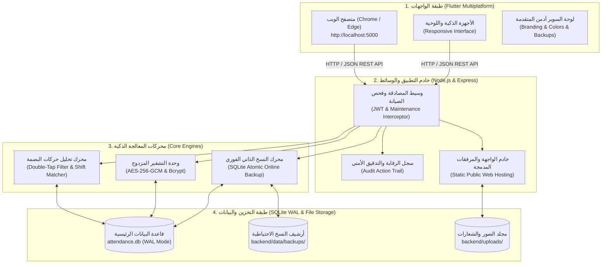
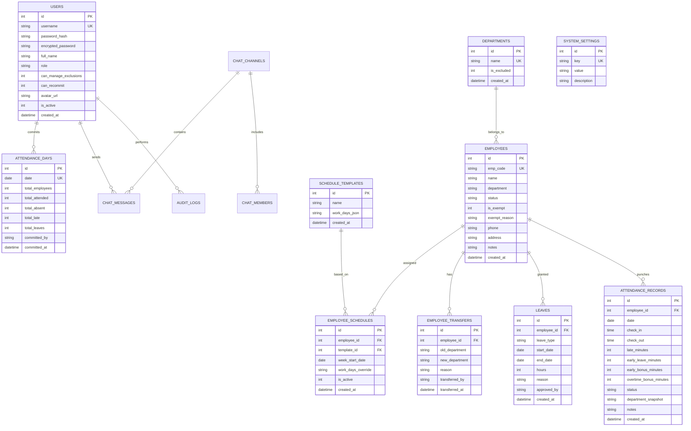
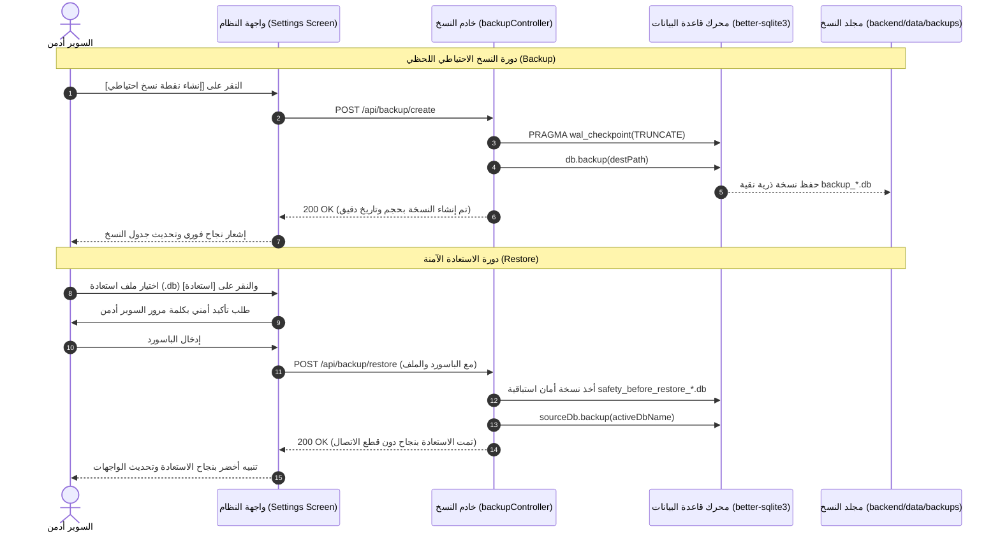

# 🏛️ المرجع الشامل والوثيقة الهندسية والتشغيلية المعتمدة
## نظام متابعة حضور وانصراف موظفي المقر (NOCI Attendance Intelligence Engine)
### اللجنة الأولمبية الوطنية العراقية — المقر العام
**الإصدار:** 2.5.0 المتكامل المعتمد  
**تاريخ الاعتماد والتوثيق:** تشرين الأول (أكتوبر) 2026  
**طبيعة الوثيقة:** المرجع السيادي والتقني الشامل لإدارة وتطوير وتشغيل وصيانة النظام

---

## 📑 الفهرس العام للمرجع

1. [الرؤية والهدف والأسس المعمارية](#1-الرؤية-والهدف-والأسس-المعمارية)
2. [المخطط المعماري الشامل وتدفق البيانات (System Architecture)](#2-المخطط-المعماري-الشامل-وتدفق-البيانات)
3. [الهيكل الشجري والفيزيائي للمشروع (Project Structure)](#3-الهيكل-الشجري-والفيزيائي-للمشروع)
4. [مخطط الكيانات وقاعدة البيانات المتكاملة (ERD & Database Schema)](#4-مخطط-الكيانات-وقاعدة-البيانات-المتكاملة)
5. [محرك البصمة الذكي وقواعد الاحتساب (Intelligence Engine)](#5-محرك-البصمة-الذكي-وقواعد-الاحتساب)
6. [نظام الصلاحيات والحماية والتشفير المزدوج (Security & RBAC)](#6-نظام-الصلاحيات-والحماية-والتشفير-المزدوج)
7. [منظومة النسخ الاحتياطي والاستعادة الفورية (Backup & Disaster Recovery)](#7-منظومة-النسخ-الاحتياطي-والاستعادة-الفورية)
8. [دليل الواجهات والشاشات والمكونات المرئية (UI/UX Catalog)](#8-دليل-الواجهات-والشاشات-والمكونات-المرئية)
9. [الفهرس الكامل لنقاط الاتصال البرمجية (API Reference Catalog)](#9-الفهرس-الكامل-لنقاط-الاتصال-البرمجية)
10. [دليل التشغيل والصيانة واستكشاف الأخطاء (Operations & Troubleshooting Runbook)](#10-دليل-التشغيل-والصيانة-واستكشاف-الأخطاء)

---

## 1. الرؤية والهدف والأسس المعمارية

صُمم نظام **NOCI Attendance Intelligence** ليكون المنظومة المركزية لإدارة وتوثيق وتحليل حضور وانصراف 292 موظفاً في مقر اللجنة الأولمبية الوطنية العراقية، مع معالجة حركات أجهزة البصمة البيومترية وفق معايير ذكية، عادلة، ومرنة تستوعب كافة التحديات الإدارية الواقعية:

### المبادئ الهندسية الحاكمة:
1. **استقلالية التشغيل والعمل دون إنترنت (Offline-First / Zero External Dependency):**
   النظام يعمل محلياً بالكامل على خادم داخلي وشبكة المقر دون الحاجة لأي اتصال خارجي، مع استخدام SQLite مدمجة فائقة السرعة بوضع WAL (Write-Ahead Logging).
2. **المعاينة الذكية قبل الاعتماد (Preview Before Commit):**
   فصل مرحلة قراءة وتحليل ملف البصمة اليومي في الذاكرة عن مرحلة الاعتماد النهائي، بما يمنح المشرف فرصة مراجعة النتائج والتأكد من الحالات الاستثنائية قبل تثبيت السجلات رسمياً.
3. **أرشفة تاريخية دقيقة غير قابلة للتلف (Audit & Ledger Trail):**
   توثيق كافة الحركات الإدارية (تعديل موظف، نقل بين الأقسام، تسجيل إجازة، تغيير إعداد، كشف كلمة مرور، استعادة قاعدة بيانات) في جدول تدقيق أمني غير قابل للتعديل.
4. **التكيف والتخصيص الحر للسوبر أدمن:**
   التحكم الكامل بأوقات الدوام، قواعد المكافآت، قوالب الدوام، ألوان الحالات، وضع الصيانة، واستثناء الأقسام والشخصيات القيادية دون تعديل سطر برمجي واحد.

---

## 2. المخطط المعماري الشامل وتدفق البيانات



---

## 3. الهيكل الشجري والفيزيائي للمشروع

```
d:\Employee NOCI\
│
├── تشغيل النظام.bat              # سكريبت الإقلاع الفوري: فحص القاعدة، تشغيل الخادم، وفتح المتصفح
├── إيقاف النظام.bat              # سكريبت إيقاف كافة العمليات النشطة على المنفذ 5000 فورياً
├── PROJECT_RULES.md             # الضوابط السبعة الصارمة لإدارة وتطوير الكود البرمجي
├── README.md                    # نبذة عامة وإرشادات التشغيل
│
├── خطط/                         # التوثيق الشامل ودفاتر الإنجاز
│   ├── تعديلات.md               # متطلبات التطوير المعتمدة
│   ├── سجل_الإنجاز_والمشاكل_والحلول.md # سجل الجلسات الخمس والتحديات والحلول الجوهرية
│   └── المرجع_الشامل_والدليل_التشغيلي_المعتمد.md # هذه الوثيقة
│
├── backend/                     # الخادم وقاعدة البيانات (Node.js & Express & better-sqlite3)
│   ├── data/                    # مجلد التخزين الفيزيائي (مستبعد من Git)
│   │   ├── attendance.db        # قاعدة البيانات الرئيسية النشطة
│   │   ├── attendance.db-wal    # سجل الكتابة المسبقة المؤقت
│   │   ├── backups/             # أرشيف ملفات النسخ الاحتياطية (.db)
│   │   └── .secrets.json        # مفاتيح التشفير العشوائية المولدة ذاتياً
│   ├── public/                  # الحزمة المجمعة لتطبيق Flutter (Production Web Build)
│   ├── uploads/                 # المرفقات المرفوعة (الشعارات والصور الشخصية)
│   │   ├── avatars/             # صور حسابات المستخدمين
│   │   └── branding/            # شعار وهوية المؤسسة
│   └── src/
│       ├── app.js               # ملف الإقلاع وتجميع المسارات وخادم الملفات الثابتة
│       ├── core/                # النواة الأساسية (القاعدة، الإعدادات، التشفير، الوسائط)
│       │   ├── database.js      # تهيئة الجداول وترقيتها التلقائية وبذر المسؤول
│       │   ├── config.js        # ثوابت النظام والمنافذ ومسارات التخزين
│       │   ├── cryptoHelper.js  # محرك AES-256-GCM للتشفير العكسي
│       │   ├── authMiddleware.js# فحص التوكن وفلترة وضع الصيانة
│       │   └── auditLogger.js   # مسجل الحركات الأمنية
│       └── features/            # الوحدات الوظيفية المقسمة معمارياً
│           ├── auth/            # الدخول، استعراض وتحديث الملف الشخصي، التحقق الأمني
│           ├── attendance/      # محرك البصمة، المعاينة، الاعتماد، والتصدير
│           ├── employees/       # دليل الموظفين، النقل بين الأقسام، الاستيراد الشامل
│           ├── leaves/          # تسجيل الإجازات، أرشيف المنتهية، العطل الرسمية
│           ├── schedules/       # قوالب الدوام والشفتات، التخصيص اليدوي، النسخ الأسبوعي
│           ├── settings/        # إدارة المؤسسة، الصيانة، الألوان، كشف كلمات المرور
│           ├── backup/          # النسخ الاحتياطي، التنزيل المباشر، والاستعادة
│           ├── chat/            # المحادثات الثنائية، المجموعات، والرقابة الأمنية
│           └── reports/         # التقارير الشهرية التحليلية وتصدير الإكسل
│
└── app/                         # واجهات المستخدم (Flutter Multiplatform Application)
    ├── lib/
    │   ├── main.dart            # نقطة انطلاق التطبيق وإدارة الثيم والجلسة ووضع الصيانة
    │   ├── core/                # إعدادات العميل (API Client, Theme, Constants, AuthProvider)
    │   ├── shared/              # الودجات المشتركة (MainLayout, CustomButton, StatusBadge, KPICard)
    │   └── features/            # شاشات النظام المتوافقة مع كافة المقاسات
    │       ├── auth/            # تسجيل الدخول وشاشة وضع الصيانة المخصصة
    │       ├── dashboard/       # لوحة المؤشرات الذكية (5 كروت رئيسية)
    │       ├── attendance/      # كشف الحضور اليومي، المعاينة، الحفظ، والتصدير
    │       ├── employees/       # سجل الموظفين، التلوين الذكي، الملف الشخصي الشامل
    │       ├── leaves/          # الإجازات السارية، الأرشيف، والعطلات الرسمية
    │       ├── schedules/       # جداول الدوام والشفتات وإدارة القوالب
    │       ├── chat/            # المحادثة الداخلية مع سجل الرقابة المقفل أمنياً
    │       ├── reports/         # التقارير الشهرية المجمعة
    │       ├── audit_logs/      # سجل التدقيق والرقابة الأمنية
    │       └── settings/        # لوحة الإعدادات الشاملة (7 تبويبات متكاملة)
    ├── web/                     # إعدادات الويب (Manifest, HTML, Icons)
    └── pubspec.yaml             # تبعيات فلاتر
```

---

## 4. مخطط الكيانات وقاعدة البيانات المتكاملة



---

## 5. محرك البصمة الذكي وقواعد الاحتساب

### هرمية التحقق من الحالة اليومية للموظف:
عند رفع كشف البصمة اليومي، يعالج المحرك حالة كل موظف مسجل وفق الترتيب الصارم الآتي:
1. **استثناء الأقسام والشخصيات القيادية:**
   إذا كان القسم مستثنى (`is_excluded = 1`) أو الموظف مستثنى قيادياً (`is_exempt = 1`)، يتم إعفاؤه وحجبه عن تقارير الغياب والعقوبات.
2. **العطلات الرسمية (`HOLIDAY`):**
   إذا وافق تاريخ اليوم عطلة مسجلة في جدول `official_holidays`، تُثبت الحالة فوراً كعطلة رسمية.
3. **أيام الراحة الأسبوعية (`OFF_DAY`):**
   وفق جدول دوام الموظف (سواء كان ثابتاً دائماً أو محدداً بأسبوع): إذا كان اليوم راحة (أوف)، تثبت حالته `OFF_DAY`.
   - **بصمة يوم الراحة:** إذا حضر الموظف وبصم في يوم راحته، تبقى الحالة `OFF_DAY` مع تسجيل ملحوظة واضحة ("حضور في يوم راحة") بدون احتساب تأخير أو غياب أو مكافأة آلية وفق توجيهات المالك.
4. **الإجازات المعتمدة (`ON_LEAVE`):**
   إذا كان للموظف إجازة سارية تغطي تاريخ اليوم، تثبت حالته فوراً كمجاز رسمياً مع ذكر نوع الإجازة.
5. **معالجة حركات البصمة:**
   - **فلتر البصمة المزدوجة المتتالية (Double Tap Filter):** تجاهل أي بصمة متتالية تسجل خلال دقيقتين لمنع التكرار العرضي للموظف.
   - **البصمة الأولى:** تُعتمد كوقت الحضور (`check_in`).
   - **البصمة الأخيرة:** تُعتمد كوقت الانصراف (`check_out`).
   - **البصمة الواحدة بعد منتصف اليوم (Missed Check-in):** إذا سجل الموظف بصمة واحدة فقط وكان وقتها بعد الساعة 12:00 ظهراً، تُعامل كبصمة خروج فقط مع تسجيل حالة `MISSED_PUNCH` وملحوظة تفيد بعدم وجود بصمة دخول صباحية دون احتساب تأخير وهمي.

### باليتة ألوان تصنيف الحضور:
| الحالة الإدارية | النطاق الزمني | اللون الدال | كود اللون |
| :--- | :--- | :---: | :---: |
| **حضور في الوقت (On Time)** | الدخول حتى 10:00 صباحاً | 🟢 أخضر | `#178A5B` |
| **تأخير بسيط (Slight Late)** | الدخول بين 10:01 إلى 10:30 | 🟡 كهرماني | `#BE7A12` |
| **تأخير كبير (Major Late)** | الدخول بعد الساعة 10:30 | 🟠 برتقالي | `#E07A10` |
| **انصراف مبكر (Early Departure)** | الخروج قبل الساعة 15:00 | 🟧 برتقالي غامق | `#D97706` |
| **غياب تام (Absent)** | لا توجد أي بصمة لموظف غير مجاز | 🔴 أحمر ملكي | `#C13B33` |
| **إجازة رسمية (Approved Leave)** | إجازة معتمدة تغطي اليوم | 🔵 أزرق | `#1E6BB8` |
| **عطلة رسمية (Official Holiday)** | يوم عطلة عامة مسجلة | 🟣 أرجواني | `#7E57C2` |
| **راحة أسبوعية (Off Day)** | يوم الراحة المعتمد بجدول الموظف | ⚪ رمادي مزرق | `#78909C` |
| **بصمة واحدة ناقصة (Missed Punch)** | تسجيل بصمة حضور فقط أو خروج فقط | 🟪 بنفسجي | `#8E44AD` |

---

## 6. نظام الصلاحيات والحماية والتشفير المزدوج

### هرمية الأدوار والصلاحيات (RBAC):
قُصرت أدوار النظام حصرياً على رتبتين:
1. **السوبر أدمن (SUPER_ADMIN):**
   تحكم مطلق في كافة الشاشات والإعدادات، قوالب الدوام، رفع الشعار، تفعيل وضع الصيانة، تصفير النظام، إدارة المستخدمين، كشف كلمات المرور، والرقابة الأمنية على المحادثات.
2. **مدخل البيانات (DATA_ENTRY):**
   رفع كشف الحضور اليومي، معاينته، اعتماده، تسجيل الإجازات، استعراض وتصدير التقارير، واستخدام المحادثة الفورية. وممنوع من دخول الإعدادات وتعديل قوالب الدوام.
   - **الصلاحيات المفوضة اختيارياً لمدخل البيانات:**
     * `can_manage_exclusions`: حق تعديل استثناء الأقسام.
     * `can_recommit`: حق إعادة اعتماد كشف يوم سبق اعتماده.

### تقنية التشفير المزدوج (Dual Encryption Architecture):
لحفظ سرية الحسابات وفي الوقت ذاته تمكين السوبر أدمن من إظهار كلمات المرور للمستخدمين عند نسيانها:
- **التشفير غير العكسي القياسي (Bcrypt - Cost Factor 10):** يُستخدم للمصادقة وتأمين تسجيل الدخول.
- **التشفير العكسي فائق الأمان (AES-256-GCM):**
  - يتم تشفير كلمة المرور وتخزينها في حقل `encrypted_password` بصيغة:
    `InitializationVector (12 Bytes) : AuthenticationTag (16 Bytes) : CipherText (Hex)`
  - المفتاح السري مولد عشوائياً بدقة 256-bit ويُحفظ حصرياً داخل ملف محمي `backend/data/.secrets.json` مستبعد تماماً من Git.
  - أي استعراض لكلمة المرور عبر زر 👁️ يسجل فورياً في سجل التدقيق الأمني موثقاً بالوقت والـ IP.

---

## 7. منظومة النسخ الاحتياطي والاستعادة الفورية



---

## 8. دليل الواجهات والشاشات والمكونات المرئية

### 1. شاشة تسجيل الدخول (`LoginScreen`):
- خلايا فارغة افتراضياً لمنع التداخل بين المستخدمين.
- خيار `[✓] تذكر بيانات تسجيل الدخول على هذا الجهاز` يعتمد على `SharedPreferences`.
- تفعيل الدخول بمفتاح Enter، مع كشف وضع الصيانة للمستخدمين العاديين وإظهار الشعار الرسمي للمؤسسة.

### 2. شاشة وضع الصيانة (`MaintenanceScreen`):
- شاشة ملكية تظهر لأي مستخدم عادي يحاول الدخول أثناء وضع الصيانة توضح خضوع النظام لأعمال التطوير مع زر إعادة الفحص وزر تسجيل الخروج.

### 3. شاشة لوحة المؤشرات (`DashboardScreen`):
- 5 كروت KPI رئيسية:
  1. إجمالي الموظفين المشمولين.
  2. الحاضرون في الوقت.
  3. المتأخرون.
  4. الغياب التام.
  5. المجازون رسمياً.
- رسم بياني تفاعلي لتوزيع الحضور ونسب الالتزام.

### 4. شاشة كشف الحضور اليومي (`AttendanceScreen`):
- تاريخ اليوم المعتمد افتراضياً.
- أزرار المعاينة الفورية `[تحليل ومعاينة]` وزر الاعتماد الموثق `[حفظ واعتماد الكشف]`.
- شريط فلاتر للحالات والبحث السريع، وزر تصدير الإكسل اليومي الشامل المنسق.

### 5. شاشة سجل الموظفين ودليل المقر (`EmployeesScreen`):
- بطاقات ذكية بشريط جانبي ملون لتمييز الحالات فورياً:
  * 🏖️ **إجازة سارية:** خلفية وشريط أزرق فاتح (`#E3F2FD`).
  * 📋 **تنسيب:** خلفية وشريط برتقالي فاتح (`#FFE0B2`) يفحص حقل الحالة والقسم.
  * 🛑 **منتهي خدماته (استقالة / متوفى):** خلفية وشريط أحمر فاتح (`#FFCDD2`).
  * ⭐ **مستثنى VIP:** خلفية وشريط رمادي فاتح (`#ECEFF1`).
- النقر على أي بطاقة يفتح نافذة الملف الشخصي الشامل:
  1. **سجل الإجازات:** كافة الإجازات السابقة والجارية وتواريخها وأسبابها.
  2. **سجل التنقلات الإدارية:** تاريخ النقل ورقم الأمر الإداري وقسمه السابق.
  3. **آخر حركات الحضور:** سجل البصمات الأخير للموظف.

### 6. شاشة الإجازات والعطلات الرسمية (`LeavesScreen`):
- مقسمة إلى 3 فلاتر رئيسية:
  * 🟢 **الإجازات السارية (الافتراضي):** تعرض فقط الإجازات النشطة والقادمة وتخفي المنتهية لمنع الازدحام.
  * 📁 **أرشيف الإجازات المنتهية:** للرجوع لأي إجازة سابقة وإحصائياتها.
  * 📋 **الكل.**
- جدول العطلات الرسمية مع تحكم السوبر أدمن بإضافتها وحذفها.

### 7. شاشة جداول الدوام والشفتات (`SchedulesScreen`):
- تبديل حر لأيام الدوام السبعة بنقرة زر (دوام 🟢 / راحة ⚪).
- دعم الجداول الثابتة الدائمة أو الأسبوعية المحددة.
- زر «نسخ الأسبوع السابق» لنقل التعيينات فوراً.
- حصر زر «إدارة قوالب الدوام» بالسوبر أدمن فقط.

### 8. شاشة المحادثة الفورية الداخلية (`ChatScreen`):
- محادثات ثنائية بين الموظفين ومحادثات جماعية مع التحقق الأمني من عضوية المجموعة.
- بادج أحمر نابض على القائمة الجانبية يوضح عدد الرسائل غير المقروءة مع تحديث تلقائي لقائمة المحادثات.
- **سجل الرقابة الشاملة:** مطوي افتراضياً بقفل أمني `🔒`، وعند النقر يطلب كلمة مرور السوبر أدمن الفعلية المحفوظة في قاعدة البيانات لفتح السجل.

### 9. شاشة الإعدادات والصيانة الشاملة (`SettingsScreen`):
تضم 7 تبويبات متكاملة حصرية للسوبر أدمن:
1. **قواعد الدوام والمكافأة:** تحديد أوقات البدء والنهاية والحضور المبكر والإضافي.
2. **الهوية والمؤسسة:** تعديل الاسم الرسمي وعنوان التطبيق، ورفع الشعار ومعاينته حياً.
3. **ألوان حالات الموظفين:** تخصيص ألوان البطاقات بالباليتات أو كود HEX مع معاينة مباشرة وحفظ فوري.
4. **استثناء الأقسام:** شمول أو استبعاد أقسام بأكملها من البصمة.
5. **المستخدمون والصلاحيات:** إضافة وتعديل وحذف المستخدمين، تفعيل/تعطيل الحساب، كشف كلمات المرور، وتفويض الصلاحيات.
6. **النسخ الاحتياطي والاستعادة:** إنشاء النسخ، التنزيل للكمبيوتر، والاستعادة الآمنة من ملف.
7. **تصفير النظام والصيانة والترحيل السنوي:** تبديل السنة الإدارية/المالية الفعالة، تفعيل وضع الصيانة، نص شريط التعاميم، وتصفير سجلات التطوير بكلمة المرور.

---

## 9. الفهرس الكامل لنقاط الاتصال البرمجية

### أولاً: مسارات المصادقة والأمان (`/api/auth`)
| الطريقة | المسار | الوصف | الصلاحية المطلوبة |
| :---: | :--- | :--- | :---: |
| `POST` | `/api/auth/login` | تسجيل الدخول وتوليد التوكن وفحص الصيانة | عام |
| `GET` | `/api/auth/me` | استرجاع بيانات الحساب الحالي والصلاحيات | مستخدم مسجل |
| `PUT` | `/api/auth/profile` | تعديل بيانات الحساب وتغيير كلمة المرور | مستخدم مسجل |
| `POST` | `/api/auth/avatar` | رفع وتحديث الصورة الشخصية للمستخدم | مستخدم مسجل |
| `POST` | `/api/auth/verify-password` | التحقق الأمني المزدوج من كلمة مرور السوبر أدمن | مستخدم مسجل |

### ثانياً: مسارات الحضور والبصمة (`/api/attendance`) والتقارير (`/api/reports`)
| الطريقة | المسار | الوصف | الصلاحية المطلوبة |
| :---: | :--- | :--- | :---: |
| `GET` | `/api/attendance/daily` | جلب سجلات حضور يوم معين مع الإحصائيات | مستخدم مسجل |
| `GET` | `/api/attendance/day-status` | فحص حالة اعتماد يوم محدد | مستخدم مسجل |
| `POST` | `/api/attendance/preview` | تحليل ملف بصمة إكسل في الذاكرة دون حفظ | مستخدم مسجل |
| `POST` | `/api/attendance/commit` | حفظ واعتماد الكشف اليومي وتوثيقه رسمياً | مدخل بيانات / سوبر أدمن |
| `POST` | `/api/attendance/recalculate` | إعادة احتساب يوم معتمد وفق القواعد المحدثة | سوبر أدمن / مفوض |
| `GET` | `/api/reports/monthly` | التقرير التراكمي الشهري للأيام المعتمدة | مستخدم مسجل |
| `GET` | `/api/reports/export-daily` | تصدير كشف الحضور اليومي كملف Excel فوري | مستخدم مسجل |
| `GET` | `/api/reports/export-monthly` | تصدير التقرير الشهري التراكمي كملف Excel فوري | مستخدم مسجل |
| `POST` | `/api/reports/export-excel` | تصدير بيانات جدول مخصص إلى ملف Excel | مستخدم مسجل |

### ثالثاً: مسارات الموظفين والتنقلات (`/api/employees`)
| الطريقة | المسار | الوصف | الصلاحية المطلوبة |
| :---: | :--- | :--- | :---: |
| `GET` | `/api/employees` | استعراض الموظفين مع فلاتر البحث والقسم والحالة | مستخدم مسجل |
| `GET` | `/api/employees/:id` | استعراض الملف الشخصي الشامل وإجازاته وتنقلاته | مستخدم مسجل |
| `POST` | `/api/employees` | إضافة موظف جديد | سوبر أدمن |
| `PUT` | `/api/employees/:id` | تعديل بيانات موظف | سوبر أدمن |
| `DELETE` | `/api/employees/:id` | حذف موظف | سوبر أدمن |
| `POST` | `/api/employees/:id/transfer` | نقل موظف لقسم آخر مع توثيق الأمر الإداري | سوبر أدمن |
| `POST` | `/api/employees/import-master` | استيراد وتحديث شامل لكادر المقر من ملف إكسل | سوبر أدمن |
| `GET` | `/api/employees/departments` | جلب قائمة الأقسام مع حالة الاستثناء | مستخدم مسجل |

### رابعاً: مسارات الإجازات والعطلات (`/api/leaves`)
| الطريقة | المسار | الوصف | الصلاحية المطلوبة |
| :---: | :--- | :--- | :---: |
| `GET` | `/api/leaves` | استعراض الإجازات مع فلتر السارية والمنتهية | مستخدم مسجل |
| `POST` | `/api/leaves` | تسجيل ومنح إجازة لموظف | مستخدم مسجل |
| `DELETE` | `/api/leaves/:id` | حذف أو إلغاء إجازة | سوبر أدمن |
| `GET` | `/api/leaves/holidays` | جلب قائمة العطلات الرسمية المعتمدة | مستخدم مسجل |
| `POST` | `/api/leaves/holidays` | إضافة عطلة رسمية جديدة | سوبر أدمن |
| `DELETE` | `/api/leaves/holidays/:id` | حذف عطلة رسمية | سوبر أدمن |

### خامساً: مسارات جداول الدوام والشفتات (`/api/schedules`)
| الطريقة | المسار | الوصف | الصلاحية المطلوبة |
| :---: | :--- | :--- | :---: |
| `GET` | `/api/schedules` | جلب جداول الموظفين لأسبوع محدد أو ثابت | مستخدم مسجل |
| `POST` | `/api/schedules/assign` | تعيين وتخصيص جدول دوام لموظف أو للمقر | مستخدم مسجل |
| `POST` | `/api/schedules/copy-previous-week` | نسخ جدول الأسبوع السابق بضغطة زر | مستخدم مسجل |
| `GET` | `/api/schedules/templates` | جلب قوالب الدوام والشفتات المعتمدة | مستخدم مسجل |
| `POST` | `/api/schedules/templates` | إنشاء قالب دوام جديد | سوبر أدمن |
| `PUT` | `/api/schedules/templates/:id` | تعديل قالب دوام | سوبر أدمن |
| `DELETE` | `/api/schedules/templates/:id` | حذف قالب دوام | سوبر أدمن |

### سادساً: مسارات النسخ الاحتياطي والاستعادة (`/api/backup`)
| الطريقة | المسار | الوصف | الصلاحية المطلوبة |
| :---: | :--- | :--- | :---: |
| `GET` | `/api/backup` | جلب قائمة ملفات النسخ الاحتياطية وتفاصيلها | سوبر أدمن |
| `POST` | `/api/backup/create` | إنشاء نقطة نسخ احتياطي فورية على السيرفر | سوبر أدمن |
| `GET` | `/api/backup/download` | تنزيل نسخة احتياطية مباشرة لجهاز المستخدم | سوبر أدمن |
| `POST` | `/api/backup/restore` | استعادة قاعدة البيانات من ملف مرفوع أو محلي | سوبر أدمن |
| `DELETE` | `/api/backup/:filename` | حذف ملف نسخة احتياطية من السيرفر | سوبر أدمن |

### سابعاً: مسارات الإعدادات والصيانة وتصفير النظام (`/api/settings`)
| الطريقة | المسار | الوصف | الصلاحية المطلوبة |
| :---: | :--- | :--- | :---: |
| `GET` | `/api/settings` | جلب كافة إعدادات النظام وألوان الحالات | مستخدم مسجل |
| `PUT` | `/api/settings` | حفظ وتعديل إعدادات النظام وألوان الحالات | سوبر أدمن |
| `PUT` | `/api/settings/maintenance` | حفظ وتحديث حالة وضع الصيانة وشريط التعاميم | سوبر أدمن |
| `POST` | `/api/settings/logo` | رفع وتحديث شعار المؤسسة الرسمي | سوبر أدمن |
| `GET` | `/api/settings/users` | جلب قائمة مستخدمي النظام ورتبهم | سوبر أدمن |
| `POST` | `/api/settings/users` | إنشاء حساب مستخدم جديد وتحديد صلاحياته | سوبر أدمن |
| `PUT` | `/api/settings/users/:id` | تعديل بيانات ورتبة وصلاحيات مستخدم | سوبر أدمن |
| `DELETE` | `/api/settings/users/:id` | حذف أو تعطيل حساب مستخدم | سوبر أدمن |
| `GET` | `/api/settings/users/:id/reveal-password` | فك تشفير وإظهار كلمة مرور المستخدم | سوبر أدمن |
| `POST` | `/api/settings/switch-year` | تبديل السنة الإدارية/المالية الفعالة في النظام | سوبر أدمن |
| `POST` | `/api/settings/reset-db` | تصفير النظام وإعادة الضبط بنمطين (`factory_default` أو `wipe_all`) مع نسخة أمان تلقائية | سوبر أدمن |

---

## 10. دليل التشغيل والصيانة واستكشاف الأخطاء

### أوامر التشغيل السريع:
- **تشغيل النظام بالكامل:**
  النقر المزدوج على ملف: `تشغيل النظام.bat`  
  *يقوم الملف بفحص قاعدة البيانات، ثم إطلاق خادم التطبيق على المنفذ الثابت `5000` وفتح المتصفح تلقائياً على الرابط:* `http://localhost:5000`
- **إيقاف النظام تماماً:**
  النقر المزدوج على ملف: `إيقاف النظام.bat`  
  *ينهي فورياً أي عملية تشغل المنفذ 5000 بأمان ودون الحاجة لإعادة تشغيل الكمبيوتر.*

### حسابات الدخول الافتراضية:
- **حساب السوبر أدمن الافتراضي:**
  - اسم المستخدم: `admin`
  - كلمة المرور: `Admin@123456`
- **حساب مدخل البيانات التجريبي:**
  - اسم المستخدم: `test`
  - كلمة المرور: `123456`

### إجراءات الصيانة الدورية وحل المشاكل الشائعة:
1. **تحديث الواجهة وظهور بيانات قديمة في المتصفح:**
   - *السبب:* قيام المتصفح بحفظ ملف `main.dart.js` أو Service Worker في الذاكرة المؤقتة (Cache).
   - *الحل:* الضغط على اختصار التحديث الإجباري: **`Ctrl + F5`** (أو `Cmd + Shift + R` في ماك).
2. **المنفذ 5000 مشغول ولم يعمل السيرفر:**
   - *الحل:* تشغيل ملف `إيقاف النظام.bat` كمسؤول ثم تشغيل `تشغيل النظام.bat`.
3. **أخذ نسخة احتياطية يدوية سريعة:**
   - الدخول كـ `admin` -> الإعدادات والصيانة -> تبويب **«النسخ الاحتياطي والاستعادة»** -> النقر على `[تنزيل نسخة احتياطية فورية على جهاز الكمبيوتر (.db)]`.
4. **تصفير بيانات الاختبار والبدء من الصفر (بنمطين اختياريين):**
   - الدخول كـ `admin` -> الإعدادات والصيانة -> تبويب **«تصفير النظام والصيانة»** -> النقر على `[تصفير النظام وإعادة الضبط للبداية]`.
   - يأخذ النظام نسخة احتياطية تلقائية للأمان (`pre_reset_safety_*.db`) قبل التنفيذ، ويوفر خيارين:
     1. **إعادة الضبط لنقطة البداية الأصلية (`factory_default`):** مسح كافة البصمات، الإجازات، العطل، الجداول، القوالب المضافة، التنقلات، المحادثات، المستخدمين الإضافيين، وسجل الحركات، مع إعادة الإعدادات وقائمة الموظفين والأقسام لنسخة الإكسل الأصلية.
     2. **تصفير شامل بالكامل (`wipe_all`):** حذف كل شيء بما في ذلك جميع الموظفين والأقسام والمستخدمين والإعدادات والسجلات ليصبح النظام فارغاً تماماً (`0` موظف) مع منع البذر التلقائي عند إعادة التشغيل.

---
**تم إعداد هذا المرجع وتدقيقه ليكون الوثيقة الهندسية والتشغيلية المعتمدة لنظام NOCI Attendance.**
