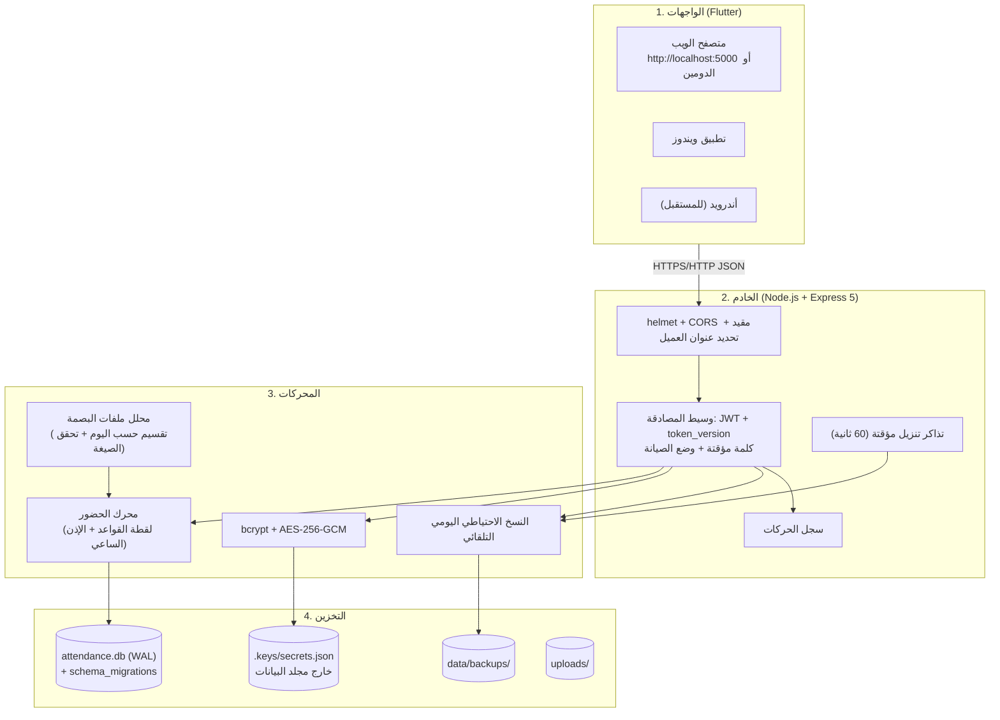

# 🏛️ المرجع الشامل والوثيقة الهندسية والتشغيلية المعتمدة
## نظام متابعة حضور وانصراف موظفي المقر (NOCI Attendance)
### اللجنة الأولمبية الوطنية العراقية — المقر العام
**الإصدار:** 2.0.0  
**آخر تحديث:** 2026-11-02  
**طبيعة الوثيقة:** المرجع التقني والتشغيلي الشامل للنظام، مطابق للكود الحالي.

> وثائق مرافقة: [README](../README.md) · [سجل الإصدارات](../CHANGELOG.md) · [دليل التثبيت والتحديث](دليل_تثبيت_الإصدار_2.0.0.md) · [تقرير الفحص الشامل وحالة الإصلاح](تقرير_الفحص_الشامل_المستقل_2026-10-29.md)

---

## 📑 الفهرس

1. [الرؤية والمبادئ](#1-الرؤية-والمبادئ)
2. [المعمارية وتدفق البيانات](#2-المعمارية-وتدفق-البيانات)
3. [هيكل المشروع](#3-هيكل-المشروع)
4. [قاعدة البيانات والترحيلات](#4-قاعدة-البيانات-والترحيلات)
5. [محرك الحضور وقواعد الاحتساب](#5-محرك-الحضور-وقواعد-الاحتساب)
6. [الصلاحيات والأمان](#6-الصلاحيات-والأمان)
7. [النسخ الاحتياطي والاستعادة](#7-النسخ-الاحتياطي-والاستعادة)
8. [الشاشات والواجهات](#8-الشاشات-والواجهات)
9. [فهرس الـ API](#9-فهرس-الـ-api)
10. [التشغيل والصيانة واستكشاف الأخطاء](#10-التشغيل-والصيانة-واستكشاف-الأخطاء)
11. [الاختبارات والجودة](#11-الاختبارات-والجودة)

---

## 1. الرؤية والمبادئ

نظام مركزي لإدارة وتوثيق وتحليل حضور وانصراف موظفي مقر اللجنة الأولمبية الوطنية العراقية، انطلاقاً من ملفات أجهزة البصمة اليومية.

### المبادئ الحاكمة
1. **العمل محلياً دون اعتماد على الإنترنت:** خادم داخلي بقاعدة SQLite بوضع WAL، مع إمكانية النشر الخارجي عبر Cloudflare Tunnel.
2. **المعاينة قبل الاعتماد، والاعتماد من الخادم فقط:** يُحلَّل الملف وتُحفظ المعاينة في الخادم بمعرّف، ثم يُعتمد اليوم بهذا المعرّف. لا تُقبل بيانات بصمة يرسلها المتصفح.
3. **ثبات التاريخ:** الكشف المعتمد لا يتغير بأثر رجعي. تُحفظ قواعد الدوام مع كل يوم معتمد، والحذف أرشفة، والتقارير تُبنى من السجلات المعتمدة ولقطة القسم.
4. **التدقيق الكامل:** كل عملية إدارية تُسجَّل في سجل الحركات بالمستخدم والوقت والعنوان الحقيقي (بما فيه خلف Cloudflare).
5. **التخصيص دون برمجة:** أوقات الدوام، والمكافآت، والقوالب، والألوان، والصيانة، والاستثناءات، كلها من شاشة الإعدادات.

---

## 2. المعمارية وتدفق البيانات



---

## 3. هيكل المشروع

```
d:\Employee NOCI\
├── تشغيل النظام.bat           # تشغيل الخادم في نافذة ظاهرة وفتح المتصفح (إغلاق النافذة يوقفه)
├── إيقاف النظام.bat           # إيقاف المشرف ثم أي خادم على المنفذ 5000
├── README.md · CHANGELOG.md · PROJECT_RULES.md
├── خطط/                       # التوثيق والخطط والتقارير
├── اساس/                      # ملف الموظفين الأساسي ونموذج كشف البصمة وخريطة الملفات
├── toolkit/                   # التشغيل في الخلفية مع الويندوز وإعداد Cloudflare
├── releases/                  # الإصدارات المبنية (غير مرفوعة إلى git)
│
├── backend/
│   ├── .keys/secrets.json     # مفتاح الجلسات ومفتاح التشفير (غير مرفوع، احتفظ بنسخة آمنة)
│   ├── data/                  # attendance.db + backups/ + temp_uploads/ (غير مرفوع)
│   ├── logs/server.log        # سجل الخادم عند التشغيل عبر المشرف (غير مرفوع)
│   ├── uploads/               # الصور الشخصية والشعار
│   ├── vendor/xlsx-0.20.3.tgz # مكتبة SheetJS الرسمية المحدّثة
│   ├── scripts/
│   │   ├── run-forever.js     # مشرف يعيد تشغيل الخادم عند التعطل مع سجل دوّار
│   │   ├── seed_employees.js  # بذر الموظفين من ملف اساس (نفس منطق الاستيراد)
│   │   └── test_engine.js     # عرض توضيحي للمحرك على الملف النموذجي
│   ├── test/                  # الاختبارات الآلية (node:test) على قواعد مؤقتة معزولة
│   └── src/
│       ├── app.js             # التجميع، الأمان، المسارات، استضافة الويب، معالج الأخطاء
│       ├── core/
│       │   ├── config.js          # المتغيرات والمفاتيح والمسارات
│       │   ├── database.js        # الجداول والترحيلات المرقّمة والبذر
│       │   ├── authMiddleware.js  # المصادقة وتذاكر التنزيل والصلاحيات
│       │   ├── rateLimiter.js     # الحماية من التخمين وتحديد عنوان العميل
│       │   ├── backupScheduler.js # النسخ الاحتياطي التلقائي والدالة المشتركة للنسخ
│       │   ├── cryptoHelper.js    # AES-256-GCM
│       │   └── auditLogger.js     # سجل الحركات
│       ├── shared/            # constants، responseHelper (+httpError)، validators
│       ├── tools/             # excelHelper (المحلل)، timeUtils (توقيت بغداد)
│       └── features/          # auth، attendance، employees (+employeeService)، leaves،
│                              # schedules، settings، backup، chat، reports، audit_logs، downloads
│
└── app/                       # Flutter
    ├── lib/
    │   ├── core/              # api_client (مهلة ومعالجة 401/503)، auth_provider، theme، constants
    │   ├── shared/            # main_layout، kpi_card، status_badge، custom_button
    │   ├── tools/             # date_formatter (أشهر عراقية + UTC←بغداد)، responsive
    │   └── features/
    │       ├── auth/          # الدخول، الصيانة، تغيير كلمة المرور الإلزامي، الملف الشخصي
    │       ├── attendance/    # الكشف اليومي، نافذة الرفع، المعاينة متعددة الأيام
    │       ├── schedules/     # الشاشة + widgets/ (نافذة التعيين، نوافذ القوالب)
    │       ├── settings/      # الشاشة + widgets/ (التأكيد الأمني، التصفير، الألوان)
    │       └── dashboard، employees، leaves، reports، chat، audit_logs
    ├── test/                  # اختبارات ApiClient و DateFormatter
    └── web/                   # index.html و manifest بالعربية
```

---

## 4. قاعدة البيانات والترحيلات

### الجداول الرئيسية
| الجدول | الغرض | أعمدة مهمة |
|---|---|---|
| `users` | المستخدمون | `role`، `token_version`، `must_change_password`، `deleted_at`، `encrypted_password` |
| `employees` | الموظفون | `emp_code` (فريد)، `department`، `status`، `is_exempt`، `deleted_at` |
| `departments` | الأقسام | `is_excluded` |
| `attendance_days` | الأيام المعتمدة | `raw_punches_json`، `stats_json`، `rules_json` (لقطة القواعد)، `committed_by` |
| `attendance_records` | سجل كل موظف في كل يوم | `department_snapshot`، `status`، دقائق التأخير/الانصراف/المكافأة/الإضافي، `year` (من التاريخ) |
| `attendance_previews` | المعاينات المحفوظة في الخادم | `id` (UUID)، `file_sha256`، `days_json`، صلاحية 24 ساعة |
| `leaves` | الإجازات | `leave_type`، `start_date`، `end_date`، `start_time`/`end_time` للإذن الساعي، `hours` |
| `official_holidays` | العطل الرسمية | `date` (فريد)، `year` من التاريخ |
| `schedule_templates` | قوالب الدوام | `work_days_json` |
| `employee_schedules` | الجداول الثابتة والأسبوعية | `schedule_type`، `week_start_date` (أحد دائماً)، `work_days_json` (نسخة ثابتة لحظة التعيين) |
| `employee_transfers` | سجل التنقلات | `from_department`، `to_department`، `transferred_by` |
| `audit_logs` | سجل الحركات | `created_at` بتوقيت UTC، `ip_address` |
| `system_settings` | الإعدادات | مفاتيح محددة بقائمة مسموحة |
| `chat_channels` / `chat_members` / `chat_messages` | المحادثة | — |
| `schema_migrations` | الترحيلات المطبقة | `version` |

### الترحيلات المرقّمة
تُطبَّق تلقائياً عند الإقلاع وبعد استعادة أي نسخة احتياطية، كل ترحيل مرة واحدة داخل معاملة:
1. أعمدة المستخدمين (`token_version`، `must_change_password`، `deleted_at`).
2. الحذف الناعم للموظفين.
3. وقت بداية ونهاية الإذن الساعي.
4. لقطة القواعد للأيام المعتمدة.
5. جدول المعاينات.
6. تصحيح سنة السجلات من التاريخ.
7. نسخ أيام القوالب داخل الجداول المعيّنة.
8. إعداد عتبة البصمة المنفردة.

> **ملاحظة توقيت:** كل طوابع `CURRENT_TIMESTAMP` محفوظة بتوقيت UTC، وتُعرض في الواجهة وتُفلتر في سجل الحركات بتوقيت بغداد (UTC+3).

---

## 5. محرك الحضور وقواعد الاحتساب

### تحليل ملف البصمة
- الأعمدة المتوقعة: المعرف، الاسم، القسم، الوقت (`YYYY-MM-DD HH:MM[:SS]`).
- الصفوف بصيغة وقت غير صالحة تُستبعد ويُبلَّغ بعددها.
- **تقسيم حسب اليوم:** الملف الذي يحوي عدة أيام يُقسَّم، ويُعاين ويُعتمد كل يوم منفصلاً.
- **فلتر البصمة المكررة:** البصمات في نفس الدقيقة تُحسب بصمة واحدة.

### الموظفون المشمولون في يوم
- عند الاعتماد الأول: كل موظف نشط، غير مستثنى، في قسم غير مستبعد، وغير محذوف.
- عند إعادة الاحتساب: نفس المجموعة **مضافاً إليها** كل من له سجل معتمد سابقاً في ذلك اليوم، حتى لو تغيرت حالته لاحقاً. ويحتفظ كل سجل بلقطة قسمه الأصلية.

### أولوية الحالة
1. **عطلة رسمية** → `HOLIDAY`.
2. **يوم راحة** حسب جدول الموظف (أسبوعي ثم ثابت ثم الافتراضي أحد–خميس) → `OFF_DAY`. البصمة في يوم الراحة تُسجَّل كملاحظة فقط.
3. **إجازة يوم كامل** → `ON_LEAVE`.
4. **لا بصمات** → `ABSENT`.
5. **تحليل البصمات:**
   - **البصمة الواحدة** بعد عتبة البصمة المنفردة (الافتراضي 12:30) تُعامل كبصمة خروج فقط → `MISSED_PUNCH`.
   - **الدخول:** قبل وقت المكافأة المبكرة يمنح دقائق مكافأة؛ وحتى بداية الدوام `ON_TIME`؛ وتأخير حتى 30 دقيقة `LATE`؛ وأكثر من ذلك `VERY_LATE`.
   - **الخروج:** قبل نهاية الدوام انصراف مبكر (ويحوّل `ON_TIME` إلى `EARLY_LEAVE`)؛ وبعد وقت الإضافي دقائق دوام إضافي.

### الإذن الساعي
- يُسجَّل ليوم واحد بوقت من/إلى، ولا يجعل اليوم `ON_LEAVE`.
- إذا غطّى بداية الدوام، تصبح بداية الدوام المتوقعة = نهاية الإذن.
- إذا غطّى نهاية الدوام، تصبح نهاية الدوام المتوقعة = بداية الإذن.
- الإذن في منتصف الدوام يُضاف كملاحظة فقط.
- مثال: إذن 10:00–11:00 ودخول 10:50 = حضور في الوقت؛ دخول 11:20 = تأخير 20 دقيقة.

### المكافآت
- **النمط الافتراضي:** المكافأة المبكرة قبل بداية الدوام بساعة، والإضافي بعد نهاية الدوام، فيتبعان أوقات الدوام تلقائياً.
- **النمط المخصص:** أوقات يحددها الأدمن.

### لقطة القواعد وإعادة الاحتساب
- تُحفظ القواعد المستخدمة مع كل يوم معتمد في `rules_json`.
- إضافة أو حذف إجازة أو عطلة، أو تعيين جدول، يعيد احتساب الأيام المعتمدة المتأثرة **بنفس قواعد يومها**.
- زر إعادة الاحتساب في شاشة الكشف يتيح خيارين: بقواعد يوم الاعتماد، أو بالقواعد الحالية.

### ألوان الحالات
| الحالة | اللون |
|---|---|
| حضور نظامي `ON_TIME` | `#178A5B` |
| تأخير بسيط `LATE` | `#BE7A12` |
| تأخير كبير `VERY_LATE` | `#E07A10` |
| انصراف مبكر `EARLY_LEAVE` | `#D97706` |
| غياب `ABSENT` | `#C13B33` |
| إجازة `ON_LEAVE` | `#1E6BB8` |
| عطلة رسمية `HOLIDAY` | `#7E57C2` |
| يوم راحة `OFF_DAY` | `#78909C` |
| بصمة ناقصة `MISSED_PUNCH` | `#8E44AD` |

---

## 6. الصلاحيات والأمان

### الأدوار
- **سوبر أدمن (`SUPER_ADMIN`):** تحكم كامل: الإعدادات، المستخدمون، الموظفون، القوالب، العطل، النسخ الاحتياطي، التصفير، سجل الحركات، ورقابة المحادثات.
- **مدخل بيانات (`DATA_ENTRY`):** رفع الكشوفات ومعاينتها واعتمادها، والإجازات، وتعيين الجداول، والتقارير، والمحادثة.
  - صلاحيات اختيارية: `can_manage_exclusions` (استثناء الأقسام)، و`can_recommit` (إعادة اعتماد يوم معتمد وإعادة احتسابه).
- **حماية آخر سوبر أدمن:** لا يمكن تعطيله أو تخفيض رتبته أو حذفه، ولا يمكن لأي مستخدم تعطيل نفسه أو تغيير رتبته.

### الجلسات
- JWT صالح 7 أيام، ويتضمن `token_version`.
- يُبطَل كل رمز سابق عند: تغيير كلمة المرور، تغيير الرتبة، التعطيل، الحذف.
- الرمز يُقبل من ترويسة `Authorization` فقط، وليس من الرابط.
- رموز الأخطاء: `401 SESSION_EXPIRED` / `401 ACCOUNT_DISABLED` / `403 PASSWORD_CHANGE_REQUIRED` / `503 MAINTENANCE`.

### كلمات المرور
- سياسة: 8 خانات على الأقل، وفيها حرف ورقم، بلا مسافات في الأطراف.
- كلمة المرور التي يحددها الأدمن (إنشاء أو إعادة تعيين) مؤقتة، ويُلزم المستخدم بتغييرها قبل أي عملية أخرى.
- كلمة مرور الأدمن الأولى في التثبيت الجديد عشوائية، وتظهر مرة واحدة في نافذة الخادم أو سجله.
- **التخزين المزدوج:** bcrypt للمصادقة، ونسخة AES-256-GCM لميزة الكشف. مفتاح التشفير في `backend/.keys/secrets.json` خارج مجلد البيانات، فلا يدخل في النسخ الاحتياطية.
- **كشف كلمة المرور:** `POST` يتطلب كلمة مرور الأدمن ويتحقق منها الخادم، مع حد للمحاولات، ويُسجَّل في سجل الحركات.

### الحماية من التخمين
- عدّاد لكل عنوان (15 محاولة خلال 15 دقيقة) وعدّاد لكل حساب (10 محاولات).
- العنوان الحقيقي: `CF-Connecting-IP` إذا جاء الطلب من loopback (أي عبر cloudflared)، وإلا عنوان الاتصال المباشر. `X-Forwarded-For` لا يُعتمد.
- مطبّق على: الدخول، والتحقق من كلمة المرور، وكشف كلمة المرور، والتصفير، وتغيير كلمة المرور.

### ترويسات وطبقات إضافية
- `helmet` بسياسة محتوى متوافقة مع Flutter، وإخفاء `X-Powered-By`.
- CORS: الأصل نفسه، وأصول `ALLOWED_ORIGINS`، وأصول localhost للتطوير فقط.
- تحقق من كل المدخلات (`shared/validators.js`)، وقائمة مفاتيح مسموحة للإعدادات.
- روابط التنزيل بتذاكر صالحة 60 ثانية، ومرتبطة بنوع الملف ومعاملاته.
- مكتبة الإكسل: SheetJS 0.20.3 الرسمية (بلا ثغرات معروفة).

### رقابة المحادثات
السوبر أدمن يستطيع الاطلاع على المحادثات الخاصة بين المستخدمين بعد تأكيد كلمة مروره.

---

## 7. النسخ الاحتياطي والاستعادة

- **تلقائي:** نسخة يومية `auto_*.db` في `backend/data/backups/` مع الاحتفاظ بآخر 30. يمكن تعطيله بـ `NOCI_DISABLE_AUTO_BACKUP=1`.
- **يدوي:** من تبويب "النسخ الاحتياطي والاستعادة"، مع تنزيل مباشر بتذكرة مؤقتة.
- **قبل التصفير:** نسخة `pre_reset_safety_*.db` إلزامية؛ إذا فشلت يُلغى التصفير بالكامل.
- **الاستعادة:**
  1. فحص أن الملف قاعدة SQLite سليمة تحتوي جداول النظام الأساسية.
  2. نسخة أمان `safety_before_restore_*.db`.
  3. الاستعادة دون قطع الاتصال.
  4. تطبيق الترحيلات على النسخة المستعادة.
- **تنبيه:** نسخة من تثبيت آخر تُستعاد بالكامل، لكن كلمات المرور المحفوظة فيها لا يمكن كشفها لاختلاف مفتاح التشفير.

---

## 8. الشاشات والواجهات

| الشاشة | أهم ما فيها |
|---|---|
| تسجيل الدخول | خيار تذكر البيانات، وضبط عنوان الخادم |
| تغيير كلمة المرور | إلزامية عند كلمة المرور المؤقتة |
| الصيانة | تظهر فوراً لغير الأدمن عند تفعيل الصيانة، حتى أثناء الجلسة |
| لوحة المؤشرات | عدد الموظفين المشمولين فعلياً، وتنبيه عند عدم اعتماد كشف اليوم، و5 بطاقات |
| كشف الحضور اليومي | الرفع، والمعاينة متعددة الأيام (اختيار اليوم)، والاعتماد، وإعادة الاحتساب بخيارين، والتصدير، واستثناء الأقسام |
| سجل الموظفين | تلوين الحالات، والملف الشخصي (إجازات وتنقلات وحضور)، والنقل، و"إظهار المحذوفين" والاستعادة، وملخص الاستيراد |
| الإجازات والعطل | الإذن الساعي بوقت من/إلى، والسارية والأرشيف، والعطل الرسمية |
| جداول الدوام | قوالب أو أيام مخصصة، أسبوعية أو ثابتة، ونسخ الأسبوع السابق، وإدارة القوالب |
| التقارير الشهرية | أيام الحضور والتأخير والانصراف المبكر والبصمة الناقصة والغياب والإجازات والعطل، ووسم "غير نشط حالياً"، والتصدير |
| المحادثة | أحدث الرسائل أولاً، وتحميل الأقدم، والمجموعات، والرقابة |
| سجل الحركات | بحث وفلترة بتوقيت بغداد |
| الإعدادات (7 تبويبات) | قواعد الدوام وعتبة البصمة المنفردة، والهوية، والألوان، واستثناء الأقسام، والمستخدمون، والنسخ الاحتياطي، والصيانة والتصفير والسنة النشطة |

الواجهة متجاوبة مع الهاتف وسطح المكتب، والتواريخ بأسماء الأشهر العراقية، وكل الأوقات بتوقيت بغداد.

---

## 9. فهرس الـ API

الصلاحية: **عام** = بلا دخول، **مستخدم** = أي مستخدم مسجل، **إدخال** = سوبر أدمن أو مدخل بيانات، **أدمن** = سوبر أدمن، **تذكرة** = رابط تنزيل بتذكرة مؤقتة.

### المصادقة `/api/auth`
| الطريقة | المسار | الوصف | الصلاحية |
|:---:|---|---|:---:|
| POST | `/login` | الدخول (يرجع `mustChangePassword`) | عام |
| GET | `/me` | بيانات المستخدم الحالي بنفس شكل الدخول | مستخدم |
| PUT | `/profile` | الاسم والصورة وتغيير كلمة المرور (يرجع رمزاً جديداً عند تغييرها) | مستخدم |
| POST | `/avatar` | رفع الصورة الشخصية | مستخدم |
| POST | `/verify-password` | تأكيد كلمة مرور المستخدم الحالي | مستخدم |

### الحضور `/api/attendance`
| الطريقة | المسار | الوصف | الصلاحية |
|:---:|---|---|:---:|
| POST | `/preview` | تحليل الملف وحفظ المعاينة (يرجع `previewId` و`days`) | إدخال |
| POST | `/commit` | اعتماد يوم بـ `{previewId, date}` | إدخال (إعادة الاعتماد تحتاج `can_recommit`) |
| GET | `/check-status?date=` | حالة اعتماد يوم | مستخدم |
| GET | `/daily?date=` | الكشف المعتمد مع الإحصائيات و`eligibleEmployees` | مستخدم |
| POST | `/recalculate` | `{date, useCurrentRules}` | أدمن أو `can_recommit` |

### التقارير `/api/reports` والتنزيل `/api/downloads`
| الطريقة | المسار | الوصف | الصلاحية |
|:---:|---|---|:---:|
| GET | `/reports/monthly?year=&month=` | التقرير الشهري للأيام المعتمدة | مستخدم |
| POST | `/reports/export-excel` | تصدير جدول مخصص | مستخدم |
| POST | `/downloads/ticket` | تذكرة تنزيل `{kind, params}` | مستخدم (`backup` للأدمن) |
| GET | `/reports/export-daily?date=&ticket=` | تصدير الكشف اليومي | تذكرة |
| GET | `/reports/export-monthly?year=&month=&ticket=` | تصدير التقرير الشهري | تذكرة |

### الموظفون `/api/employees`
| الطريقة | المسار | الوصف | الصلاحية |
|:---:|---|---|:---:|
| GET | `/` | القائمة (`includeDeleted=true` لإظهار المحذوفين) | مستخدم |
| GET | `/departments` | الأقسام وحالة الاستثناء | مستخدم |
| GET | `/:id` | الملف الكامل | مستخدم |
| PUT | `/departments/:id/exclusion` | استثناء قسم | أدمن أو `can_manage_exclusions` |
| POST | `/` | إضافة موظف | أدمن |
| PUT | `/:id` | تعديل (تغيير القسم يُسجَّل كتنقل) | أدمن |
| DELETE | `/:id` | حذف ناعم (أرشفة) | أدمن |
| POST | `/:id/restore` | استعادة موظف محذوف | أدمن |
| POST | `/:id/transfer` | نقل بين الأقسام | أدمن |
| PUT | `/:id/vip-exempt` | استثناء VIP | أدمن |
| POST | `/import-excel` | استيراد مع ملخص تفصيلي | أدمن |

### الإجازات والعطل `/api/leaves`
| الطريقة | المسار | الوصف | الصلاحية |
|:---:|---|---|:---:|
| GET | `/` | الإجازات (فلترة بالتداخل مع الشهر/السنة) | مستخدم |
| POST | `/` | إجازة (الساعية تحتاج `startTime` و`endTime`) | إدخال |
| DELETE | `/:id` | حذف إجازة | إدخال |
| GET | `/holidays` | العطل الرسمية | مستخدم |
| POST | `/holidays` | إضافة عطلة | أدمن |
| DELETE | `/holidays/:id` | حذف عطلة | أدمن |

### جداول الدوام `/api/schedules`
| الطريقة | المسار | الوصف | الصلاحية |
|:---:|---|---|:---:|
| GET | `/templates` | القوالب | مستخدم |
| POST / PUT / DELETE | `/templates[/:id]` | إدارة القوالب | أدمن |
| GET | `/assignments?weekStartDate=` | تعيينات الأسبوع | مستخدم |
| POST | `/assign` | تعيين بقالب أو أيام مخصصة | إدخال |
| POST | `/copy-previous-week` | نسخ الأسبوع السابق | إدخال |

### المحادثة `/api/chat`
| الطريقة | المسار | الوصف | الصلاحية |
|:---:|---|---|:---:|
| GET | `/conversations` | المحادثات والمجموعات (والرقابة للأدمن) | مستخدم |
| GET | `/messages?type=&targetId=&beforeId=&afterId=` | أحدث 150 رسالة، مع تحميل الأقدم والجديد | مستخدم |
| POST | `/messages` | إرسال (حتى 2000 حرف) | مستخدم |
| POST | `/groups` | إنشاء مجموعة | أدمن |
| GET | `/unread-count` | عدد غير المقروء | مستخدم |

### الإعدادات `/api/settings`
| الطريقة | المسار | الوصف | الصلاحية |
|:---:|---|---|:---:|
| GET | `/` | كل الإعدادات | مستخدم |
| PUT | `/` | حفظ (مفاتيح مسموحة فقط مع تحقق) | أدمن |
| POST | `/logo` | رفع الشعار | أدمن |
| GET / POST | `/users` | قائمة وإنشاء المستخدمين | أدمن |
| PUT / DELETE | `/users/:id` | تعديل وحذف ناعم | أدمن |
| POST | `/users/:id/reveal-password` | كشف كلمة المرور `{adminPassword}` | أدمن |
| POST | `/reset-db` | التصفير `{password, resetMode}` | أدمن |
| POST | `/switch-year` | تبديل السنة النشطة | أدمن |

### النسخ الاحتياطي `/api/backup` وغيره
| الطريقة | المسار | الوصف | الصلاحية |
|:---:|---|---|:---:|
| GET | `/backup` | قائمة النسخ | أدمن |
| POST | `/backup/create` | نسخة يدوية | أدمن |
| GET | `/backup/download?filename=&ticket=` | تنزيل | تذكرة + أدمن |
| POST | `/backup/restore` | استعادة من ملف أو باسم نسخة | أدمن |
| DELETE | `/backup/:filename` | حذف نسخة | أدمن |
| GET | `/audit-logs` | سجل الحركات | أدمن |
| GET | `/system/status` | حالة النظام والهوية | عام |

---

## 10. التشغيل والصيانة واستكشاف الأخطاء

### التشغيل والإيقاف
- **تشغيل يدوي:** `تشغيل النظام.bat`، ويفتح المتصفح على `http://localhost:5000`. إغلاق النافذة يوقف الخادم.
- **تشغيل في الخلفية مع الويندوز:** `toolkit/install-startup-service.bat` مرة واحدة، فيعمل الخادم عبر المشرف `run-forever.js` مع إعادة تشغيل تلقائية وسجل في `backend/logs/server.log`.
- **إيقاف:** `إيقاف النظام.bat` يوقف المشرف أولاً ثم الخادم.

### متغيرات البيئة (`backend/.env`)
| المتغير | الافتراضي | الوصف |
|---|---|---|
| `PORT` | `5000` | المنفذ |
| `HOST` | `0.0.0.0` | ضعه `127.0.0.1` عند الاكتفاء بالنشر عبر Cloudflare |
| `ALLOWED_ORIGINS` | فارغ | أصول CORS إضافية |
| `KEYS_DIR` | `backend/.keys` | مجلد المفاتيح |
| `JWT_SECRET` / `CIPHER_KEY` | من ملف المفاتيح | تمرير المفاتيح من البيئة |
| `DB_PATH` | `backend/data/attendance.db` | مسار القاعدة |
| `UPLOADS_DIR` | `backend/uploads` | مجلد المرفقات |
| `NOCI_INITIAL_ADMIN_PASSWORD` | عشوائي | كلمة مرور الأدمن الأولى في التثبيت الجديد |
| `NOCI_DISABLE_AUTO_BACKUP` | فارغ | `1` لتعطيل النسخ التلقائي |

### النشر عبر Cloudflare
`toolkit/setup-cloudflare-tunnel.ps1` يثبّت cloudflared (عبر winget أو مع فحص التوقيع)، وينشئ النفق ويربطه بالدومين. بعده اضبط `HOST=127.0.0.1`.

### حلول المشاكل الشائعة
| المشكلة | الحل |
|---|---|
| الواجهة تعرض نسخة قديمة | تحديث إجباري `Ctrl + F5` |
| المنفذ 5000 مشغول | `إيقاف النظام.bat` ثم التشغيل من جديد |
| "انتهت صلاحية الجلسة" بعد التحديث أو تغيير كلمة المرور | سلوك مقصود؛ سجّل الدخول مجدداً |
| رفض حفظ الإعدادات | الأوقات بصيغة `HH:MM` من رقمين، والنهاية بعد البداية، والعتبة بينهما |
| "تم تجاوز الحد المسموح للمحاولات" | انتظر 15 دقيقة |
| رابط التصدير لا يعمل | الرابط صالح 60 ثانية فقط؛ اضغط زر التصدير مجدداً |
| نسيان كلمة مرور الأدمن الوحيد | أي سوبر أدمن آخر يعيد تعيينها من تبويب المستخدمين؛ احرص على وجود أكثر من حساب أدمن |
| فقدان `backend/.keys/secrets.json` | الدخول يعمل، لكن كشف كلمات المرور المحفوظة يتعذر وتنتهي الجلسات؛ أعد تعيين كلمات المرور |

### التصفير
من تبويب "تصفير النظام والصيانة"، بكلمة مرور الأدمن، بعد نسخة أمان إلزامية:
- **`factory_default`:** مسح الحركات والمستخدمين الإضافيين والقوالب المضافة والسجلات، وإعادة الإعدادات والموظفين من ملف الإكسل الأصلي.
- **`wipe_all`:** مسح كل شيء ليصبح النظام فارغاً تماماً، مع منع البذر التلقائي.

---

## 11. الاختبارات والجودة

```bash
cd backend && npm test
```
```bash
cd app && flutter analyze && flutter test
```

- **الخادم:** 37 اختباراً تعمل على قواعد ومفاتيح مؤقتة معزولة، ولا تلمس الإنتاج.
- **الواجهة:** تحليل بالقواعد الكاملة دون أي إخفاء، واختبارات للاتصال وتنسيق التواريخ.
- **المكتبات:** `npm audit` بلا ثغرات.

---
**هذا المرجع مطابق للإصدار 2.0.0، ويُحدَّث مع كل تغيير جوهري في النظام.**
