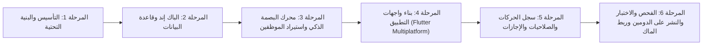

# 🗺️ خطة العمل التنفيذية المعتمدة
## مشروع نظام البصمة وحضور وانصراف موظفي المقر (NOCI Attendance)

---

## 📌 مراحل التنفيذ المعتمدة

---

### جدول المهام التفصيلي

| المرحلة | الحالة | المخرجات الرئيسية |
|:---|:---:|:---|
| **المرحلة 1: التأسيس والبنية التحتية** | 🔄 قيد التنفيذ | تثبيت القواعد، إنشاء مجلدات المشروع (`app`, `backend`, `toolkit`, `خطط`)، وضبط الهوية التصميمية والألوان الملكية |
| **المرحلة 2: الباك إند وقاعدة البيانات** | ⏳ قادمة | تأسيس خادم الـ API، مخطط قاعدة البيانات (SQLite/Prisma)، جداول الموظفين، البصمات، سجل الحركات، الإعدادات، والإجازات |
| **المرحلة 3: استيراد الموظفين ومحرك البصمة** | ⏳ قادمة | استيراد الـ 292 موظفاً من `اسماء موظفين المقر.xlsx`، معالجة ملف البصمة اليومي `20-10-2026.xlsx`، وتطبيق خوارزمية التدرج اللوني والتأخير والمكافآت |
| **المرحلة 4: بناء واجهات التطبيق (Flutter Multiplatform)** | ⏳ قادمة | تقسيم التطبيق بهيكلية (Core, Features, Shared, Tools)، شاشات الدخول، لوحة المؤشرات، كشف الحضور، إدارة الموظفين، والمحادثة الفورية |
| **المرحلة 5: سجل الحركات والصلاحيات والإجازات** | ⏳ قادمة | شاشة سجل الحركات (Audit Logs) للسوبر أدمن، شريط التنبيهات، وضع الصيانة، واستثناء الشخصيات العليا (VIP) |
| **المرحلة 6: حزمة النشر وربط الدومين وبناء الماك** | ⏳ قادمة | إعداد نفق Cloudflare على `Employee.nociraq.com`، سكريبتات `toolkit`، ودليل بناء نسخة iOS على الماك |
